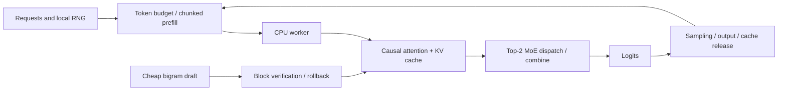

# nano-deepseek-infer

[中文](README.md) | [English](README.en.md)

**Eight executable NumPy experiments for understanding DeepInfer-style inference optimizations.**

[](https://github.com/PeriodBLUE/nano-deepseek-infer/actions/workflows/test.yml)

Bilingual READMEs · Python + NumPy · CPU · No weight downloads · Eight labs + shape tour + independent reference

> Independent educational project, not affiliated with DeepSeek. The model is randomly initialized single-layer attention + top-2 MoE; generated text has no learned language meaning. This project studies mechanisms and invariants, does not load DeepSeek weights, and makes no production performance claims.

## Capability and resource matrices

The organizing question is: **when caching, drafting, expert placement or scheduling changes, which results must remain invariant, and where does the extra work go?**

CPU execution, no-download examples and numerical tests already exist in related projects. Our focus is their combination with **one small NumPy model, observable system state, reference comparisons and optimization counterexamples**.

**Legend: ✓ implementation or explicit documentation; ✗ explicitly unsupported or does not meet the column's definition; — not verified in this review; ✓\* conditional, see notes.** Unknown is not unsupported, and a check is not automatically an advantage. Other projects were reviewed at pinned revisions on 2026-10-21; we did not run a cross-project benchmark. [Evidence and revisions](docs/comparison.md)

### Execution requirements and model use

| Project | CPU tiny path | NumPy-only runtime | Default demo needs no weights download | Text generation with trained weights |
|---|:---:|:---:|:---:|:---:|
| [Alexander-Qiu/nano-deepinfer](https://github.com/Alexander-Qiu/nano-deepinfer) | ✓ | ✗ | ✗¹ | ✓ |
| [singzhou/nano-deepseek-v4-inference](https://github.com/singzhou/nano-deepseek-v4-inference) | ✓ | ✗ | ✓ | ✗ |
| [hebo1221/nano-deepseek-v4](https://github.com/hebo1221/nano-deepseek-v4) | ✓ | ✗ | ✓ | ✓\*² |
| [GeeeekExplorer/nano-vllm](https://github.com/GeeeekExplorer/nano-vllm) | ✗ | ✗ | ✗ | ✓ |
| **This project** | **✓** | **✓** | **✓** | **✗** |

¹ The default example downloads SmolLM2-135M; separate tiny tests do not need weights. ² Its locally trained native bundle supports generation; this does not imply an official DSpark checkpoint runtime.

### Mechanisms and verification scope

| Project | V4 architecture components | Independent numerical reference | DSpark equation checks | Cross-request prefix reuse | Expert replica placement lab |
|---|:---:|:---:|:---:|:---:|:---:|
| Alexander-Qiu/nano-deepinfer | ✗ | ✓ | — | — | — |
| singzhou/nano-deepseek-v4-inference | ✓\*³ | — | ✗ | — | — |
| hebo1221/nano-deepseek-v4 | ✓\*³ | ✓ | ✓\*⁴ | — | — |
| GeeeekExplorer/nano-vllm | — | — | — | ✓ | — |
| **This project** | **✗** | **✓\*⁵** | **✗** | **✓\*⁶** | **✓\*⁷** |

³ Tiny reference architectures, not official-weight or production-kernel parity. ⁴ CPU equation/scheduler vectors, not official-weight speculative serving. ⁵ Independent control flow for the toy equations, sharing weights and NumPy; not a separate inference backend. ⁶ Explicit shared prefix with copied branch arrays; no paging, automatic matching or eviction. ⁷ Single-process physical-expert simulation without real device communication.

## What we learned and implemented

| Inspiration | Implemented here | Verification and limit |
|---|---|---|
| nano-deepinfer's Transformers comparisons; hebo's independent oracles and recorded verification | [`verify`](nano_infer/verification.py): token-wise attention/MoE reference, runtime versions and source SHA-256 digests | Full/cached agreement; deliberate future leakage, missing positions and missing MoE are detected. Toy equations only |
| singzhou's tensor-shape annotations; hebo's model tour | [`tour`](nano_infer/verification.py): observed embedding, Q, KV, attention, MoE and logits shapes | Collected during actual prefill/decode execution, not a hard-coded diagram |
| nano-vLLM's cross-request prefix caching | [`demo prefix`](nano_infer/prefix.py): compute a shared prefix once, fork independently mutable KV branches | Compare with full per-request recomputation; test branch isolation. No paged block manager |

These additions retain a NumPy-only runtime. We also expose draft acceptance/rollback traces, a cold-start budgeting counterexample and a [pinned DeepInfer source map](docs/upstream-map.md). The related projects remain useful next steps for full V4 architecture, real checkpoint integration and GPU engineering.

## Run in three minutes

Requires Python 3.10+. Works on Windows, Linux and macOS; NumPy is the only runtime dependency.

```bash
git clone https://github.com/PeriodBLUE/nano-deepseek-infer.git
cd nano-deepseek-infer
python -m venv .venv
```

Activate the environment using the appropriate command:

```bash
# Linux / macOS
source .venv/bin/activate
# Windows PowerShell
.\.venv\Scripts\Activate.ps1
```

```bash
python -m pip install -e .
python -m nano_infer demo all
python -m nano_infer tour
python -m nano_infer verify
python -m unittest discover -s tests -v
```

If PowerShell blocks activation, replace `python` with `.\.venv\Scripts\python.exe`; no system execution-policy change is needed.

Inspect traces and save results:

```bash
python -m nano_infer demo speculative --trace
python -m nano_infer demo scheduling --trace
python -m nano_infer demo all --json lesson-results.json
python -m nano_infer verify --json verification.json
python -m nano_infer tour --json shape-tour.json
python -m nano_infer generate --prompt "nano" --max-tokens 24
```

The toy tokenizer accepts lowercase English letters, digits, spaces and a few punctuation characters. It does not support Chinese generation. After installation, `nano-infer` is also available as a command.

## Eight experiments

| Lab | Question | Implementation and check |
|---|---|---|
| `cache` | Why avoid recomputing the prefix during decode? | Real causal attention; cached and uncached token outputs agree |
| `prefix` | Can several requests compute their common prefix once? | Reuse prefix KV with independent branches; compare against full recomputation |
| `speculative` | How do rejected drafts recover? How much should we draft? | Block verification, transactional rollback, fixed vs historical budgets |
| `moe` | How can replicas reduce expert hotspots? | Top-2 routing, expert matrix computation, physical placement and combine equivalence |
| `context` | Can we average shard-local softmax outputs? | Merge maxima, normalization sums and weighted values; compare with full attention |
| `replay` | When is replaying only a suffix valid? | Single-layer SWA, absolute positions and rollback allowance; boundary/decode agreement |
| `scheduling` | How do long prompts coexist with short requests? | Token budgets, chunked prefill, request completion, CPU lookahead and per-request RNG |
| `structured` | How can sampling obey a format? | Mask legal next characters and generate one of two valid JSON strings |

Each lab checks its contract before reporting results. Checked-in examples: [lab output](examples/results.json), [observed shapes](examples/shape-tour.json), [reference verification](examples/verification.json). Last-bit errors may differ across NumPy/BLAS versions. Verification records runtime versions, source digests, four fixtures and fault detection; digests identify source content, not signatures or official conformance certification.

One run of the default configuration shows:

- **KV reuse:** projected tokens fall from `708` to `41`, with identical output tokens. This counts work, not wall-clock speedup.
- **Shared prefix:** three requests share `29` tokens. Projected tokens fall from `149` to `91`, saving `58` token projections. Branch copying still costs memory and bandwidth.
- **Fixed drafts:** target calls fall from `48` to `26`, while projected tokens rise from `61` to `156`. Fewer calls do not guarantee faster CPU execution.
- **Cold-start adaptive drafts:** poor early drafts cause the simple controller to stop drafting; target calls become `49`. It has no exploration mechanism.
- **MoE:** simulated rank routes change from `[80, 48]` to `[66, 62]`, with output error below `1e-12`. Gains depend on the workload.
- **Suffix replay:** window `8` plus rollback allowance `3` reduces this single-layer prompt replay from `43` tokens to `11`.

## Code structure



Scheduling and single-request speculative decoding are separate learning paths sharing `TinyModel`. This keeps each state machine independently inspectable.

Suggested reading order:

1. [model.py](nano_infer/model.py): KV appends and the shared prefill/decode interface.
2. [decoding.py](nano_infer/decoding.py): pending tokens, rollback and local sampling.
3. [parallel.py](nano_infer/parallel.py): logical experts vs physical copies and softmax merging.
4. [engine.py](nano_infer/engine.py): ready queues, immutable work plans and output commits.
5. [labs.py](nano_infer/labs.py) and [core tests](tests/test_core.py): executable invariants.
6. [verification.py](nano_infer/verification.py), [prefix.py](nano_infer/prefix.py) and [added tests](tests/test_verification.py): independent reference, observed shapes and prefix branches.

## DeepInfer mapping and limits

Source review is pinned to DeepInfer [`774ce244b87cc0eb8d4b94ab9f5de2ab22049f01`](https://github.com/deepseek-ai/DeepInfer/tree/774ce244b87cc0eb8d4b94ab9f5de2ab22049f01), reviewed on 2026-10-21. The [source map](docs/upstream-map.md) links files and symbols.

| Upstream design | Kept here | Omitted |
|---|---|---|
| Kernels and model runtime | Real NumPy attention and MoE computations | MLA, sparse attention, FP8, fused kernels, CUDA Graph |
| EP + EPLB | Logical/physical mapping, replication, dispatch and combine | Processes, network communication, weight migration, multi-step optimization |
| Balanced CP | Numerically correct softmax shard merge | Upstream zigzag/mirror query layout and real collectives |
| DSpark/DFlash and confidence scheduling | Greedy verification, rollback, historical budgeting | Trained heads, upstream temporal protocol and stochastic speculative sampling |
| SWA bounded replay | A single-layer local-dependency example | Full YoCo, shared cross-layer caches, compressed/sparse states |
| Asynchronous scheduling | Prepare other ready requests while a worker runs | Same-request lookahead and GPU streams/events |
| Batch invariance | Fixed per-request computation and independent RNGs | Efficient batch kernels with cross-shape bitwise invariance |
| Structured output | A finite candidate-string grammar | General JSON Schema, regex or EBNF compilation |

“Batch” means a scheduling batch; the worker executes requests individually. EP/CP ranks are simulated in one process. There is no HTTP service, distributed KV service or multi-node deployment.

Further reading: [design derivation, Chinese](docs/design.md) · [exercises, Chinese](docs/exercises.md) · [comparison evidence, Chinese](docs/comparison.md)

## Tests and license

20 tests cover cached/block equivalence, full acceptance/rejection, length bounds, rollback, expert copies, context shards, SWA boundaries, request order/batch size/pipeline mode, EOS, cache release, prefix isolation and the independent oracle. GitHub Actions runs Windows/Linux × Python 3.10/3.12 and uploads lab, shape and verification results.

Original code is [MIT licensed](LICENSE). Upstream DeepInfer is Apache-2.0; its code and weights are not vendored here. See [attribution](NOTICE.md).
