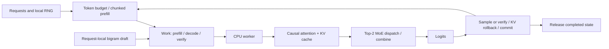

# nano-deepseek-inference: DeepSeek Inference from Scratch

**[English](README.md)** | [简体中文](README.zh-CN.md)

**Learn AI Infra by building and running a NumPy LLM inference engine on CPU: DeepInfer design, KV cache, MLA, MoE, speculative decoding, continuous batching, and HTTP serving.**

[](https://github.com/PeriodBLUE/nano-deepseek-inference/actions/workflows/test.yml)

For beginners and aspiring inference engineers · English + Chinese · NumPy only · CPU training and generation

Why does generating one token read historical KV? Why can drafting more tokens make decoding slower? Why can expert replication reduce imbalance while changing the router would change the model?

Start with [`infer.py`](infer.py): **live arrivals → chunked prefill → scheduled draft verification → KV commit/rollback → output and release.** The whole path uses NumPy and checks outputs against full-prefix recomputation. Explore details through eight focused labs, measure a fixed workload with [`bench.py`](bench.py), then follow the corresponding DeepInfer source.

[Run the project](#run-in-three-minutes) · [System design and interview guide](docs/interview-guide.en.md) · [DeepInfer source map](docs/upstream-map.md) · [Related projects](#capability-and-resource-matrices)


## Run in three minutes

Requires Python 3.10+. Works on Windows, Linux and macOS; NumPy is the only runtime dependency.

```bash
git clone https://github.com/PeriodBLUE/nano-deepseek-inference.git
cd nano-deepseek-inference
python -m venv .venv
```

Activate the environment using the appropriate command:

```bash
# Linux / macOS
source .venv/bin/activate
# Windows PowerShell
.\.venv\Scripts\Activate.ps1
```

```bash
python -m pip install -e .
python -m nano_infer generate --checkpoint checkpoints/tiny-trained.npz --prompt "the model " --max-tokens 64
python infer.py
```

If PowerShell blocks activation, replace `python` with `.\.venv\Scripts\python.exe`; no system execution-policy change is needed.

A default-run excerpt: `r1` arrives after `r0` has started decoding. `input` includes pending and draft tokens; `rollback` counts discarded KV entries.

```text
step request phase    input draft accept rollback cache     output
   1 r0      verify       5     4      0        4 4->5      '6'
  + r1: 'deepseek inference'
   2 r0      verify       5     4      0        4 5->6      'u'
   2 r1      prefill      3     0      0        0 0->3      ''
   3 r0      verify       5     4      4        0 6->11     'uuuuu'
   3 r1      prefill      3     0      0        0 3->6      ''
```

Every run checks output equivalence and cache release. The excerpt above uses seeded weights for a compact state trace; the trained path below uses the same engine.

**Change one parameter and test one hypothesis:**

```bash
python infer.py --draft-tokens 0
python infer.py --draft-tokens 4 --token-budget 3 --prefill-chunk 2
python infer.py --prompt "nano" --prompt "cache" --arrival-gap 1
python bench.py --repeats 5 --json benchmark.json
```

`bench.py` fixes inputs, model seed and output length, comparing cached, fixed-draft, adaptive-draft and pipelined-draft execution. It warms up each policy and rotates measurement order, reporting CPU wall time, throughput and work. JSON includes raw samples, environment and source digests. Timing includes engine execution, excluding model construction and the correctness oracle. **An optimization is allowed to be slower.**

Inspect individual mechanisms and verify:

```bash
python -m nano_infer tour
python -m nano_infer verify
python -m unittest discover -s tests -v
python -m nano_infer demo speculative --trace
python -m nano_infer demo scheduling --trace
python -m nano_infer demo all --json lesson-results.json
python -m nano_infer verify --json verification.json
python -m nano_infer tour --json shape-tour.json
python -m nano_infer generate --prompt "nano" --max-tokens 24
```

The toy tokenizer accepts lowercase English letters, digits, spaces and a few punctuation characters. It does not support Chinese generation. After installation, `nano-infer` is also available as a command.

## Train weights, then serve text

The repository includes an 87,936-parameter CPU-trained attention + top-2 MoE checkpoint. Load it directly, or train all model parameters yourself using explicit NumPy backprop and Adam:

```bash
python -m nano_infer generate --checkpoint checkpoints/tiny-trained.npz --prompt "the model " --max-tokens 64
python infer.py --checkpoint checkpoints/tiny-trained.npz --prompt "the model " --max-tokens 64 --json trained-trace.json
python train.py
python bench.py --checkpoint checkpoints/tiny-trained.npz --repeats 5 --json trained-benchmark.json
python infer.py --checkpoint artifacts/tiny-trained.npz --prompt "the model " --max-tokens 64
python -m nano_infer.dspark --json dspark.json
```

[`train.py`](train.py) connects next-character loss, causal attention/MoE gradients, clipping, Adam, validation, checkpoint save/reload and generation. [`data/`](data/) contains the original English training and held-out texts. Inspect the [trained inference trace](examples/trained-inference.json) and [trained benchmark](examples/trained-benchmark.json). [Training results](examples/training.json) record configuration, losses, samples and weight/data digests. The [training walkthrough](docs/training.md) explains tensor shapes, routing derivatives and evaluation. The character vocabulary supports lowercase English and selected punctuation.

**DSpark is executable too:** the [equation lab](docs/dspark.md) covers feature projection/RMSNorm, Markov-corrected logits, pre-norm confidence, per-step temperature and two-generation scheduling. Compare 24 head fixtures with scalar equations and 80 scheduler fixtures with an exhaustive oracle. Every candidate budget exposes expected tokens, graph bucket, time and throughput.

## Run the complete inference systems path

```bash
python systems.py --json systems.json
python infer.py --checkpoint checkpoints/tiny-trained.npz --batched --kv-blocks 64 --prompt "the model " --prompt "the cache " --max-tokens 32
python bench.py --checkpoint checkpoints/tiny-trained.npz --batched --repeats 5
python load_test.py --requests 8 --json service-load.json
python serve.py --checkpoint checkpoints/tiny-trained.npz
```

| Core design | Executable implementation | What you can explain in an interview |
|---|---|---|
| **Real batching** | Padded batched Q/K/V and attention, per-request absolute masks, live-row MoE | Why a scheduling batch is different from a matrix batch; how padding changes cost |
| **Paged KV ownership** | Block tables, free list, reference counts, COW tails, atomic capacity checks; longest-prefix LRU store | How sharing, rollback, eviction and request release interact |
| **DeepSeek-V2 MLA** | Expanded-KV reference versus absorbed latent-cache attention with decoupled RoPE | Derive the memory reduction and explain which matrix products move |
| **A working HTTP service** | Bounded admission, FIFO queue, KV reservation, incremental polling, cancellation, deadlines and failure recovery | Trace a request from queue to terminal state and account for its resources |
| **Request latency** | HTTP load generator with raw timestamps, queue time, TTFT, ITL, TPOT and percentiles | Distinguish server commit latency, client throughput and speculative token bursts |

[Walk through every design and API](docs/systems.en.md) · [Numerical and memory results](examples/systems.json) · [HTTP load results](examples/service-load.json) · [Batched engine trace](examples/batched-inference.json) · [Batched benchmark](examples/batched-benchmark.json)

The numerical fixture uses 1,632 bytes of latent KV versus 7,072 bytes expanded, with output error below `1e-12`. The batch fixture executes 11 live query tokens as 15 padded rows in one forward. These results make both the saving and its execution cost visible.

## What you will learn

| Learning advantage | What you can demonstrate | Starting point |
|---|---|---|
| **Training to serving** | Derive gradients, train weights, reload a checkpoint and generate through the same cache/scheduler | [`train.py`](train.py) · [Training walkthrough](docs/training.md) |
| **DSpark from equations to decisions** | Explain pre-norm confidence, Markov recurrence and generation-isolated budget selection | [DSpark lab](docs/dspark.md) · [Reference](nano_infer/dspark_reference.py) |
| **A complete request lifecycle** | Change arrival times and draft budgets; follow prefill, verification, rollback and completion in one scheduler | [`infer.py`](infer.py) · [`Engine`](nano_infer/engine.py) |
| **Visible tensors and state** | Read actual prefill/decode shapes, draft acceptance, cache rollback and scheduling traces | `tour` · `demo speculative --trace` · `demo scheduling --trace` |
| **Testable optimization arguments** | Explain what must remain invariant and detect causal-mask, position and branch-isolation errors | `verify` · [Correctness](docs/interview-guide.en.md#7-prove-that-an-optimization-preserves-results) |
| **Benefits and costs together** | Compare CPU time, target calls and projection work with identical inputs and outputs | [`bench.py`](bench.py) · [Performance reasoning](docs/interview-guide.en.md#8-answer-performance-questions) |
| **A path into production source** | Find scheduling, EPLB, DSpark, YoCo and sampling entry points, and explain the gap from each teaching example | [Source map](docs/upstream-map.md) · [Next steps](docs/interview-guide.en.md#9-continue-into-deepinfer-and-model-architecture) |

## What you can bring to an Infra interview

You can explain a trained model from loss to generated text; trace prefill/decode and KV ownership; derive DSpark head and budget equations; and defend an optimization using controlled measurements. Each outcome has code, a runnable command and a saved result.

| Official role reviewed | Practice in this repository | Evidence to explain |
|---|---|---|
| Anthropic — Inference Engine | Batching, cached state and determinism | Arrival/rollback/release trace and regression tests |
| OpenAI — Inference Performance Optimization | Workload and cost analysis | CPU benchmark and DSpark candidate cost curve |
| NVIDIA — Inference Performance Engineer | KV, MoE, speculation and controlled experiments | Work counters, replica loads and output checks |
| Together AI — ML Engineer, Inference | Runtime integration, reliability and tooling | Training→checkpoint→engine and failure tests |

[Official JD links, skill checklist and interview deliverables](docs/career-map.en.md) — reviewed 2026-10-21. Follow the checklist to produce your own model, engine, memory and HTTP measurements.

## From a first run to a design explanation

You do not need to read the entire repository first. Follow this sequence and produce evidence you can explain at each stage.

| Stage | Run and read | Question to answer independently |
|---|---|---|
| 1. Understand a forward pass | `tour`, `demo cache`; `model.py` | Why are scores `4×4` during prefill and `1×5` in the next decode step? What does KV store? |
| 2. Follow request state | `python infer.py`; `engine.py`; then `demo prefix` | How do new requests enter a running engine? How does the token budget constrain drafts? Which state belongs to a request? |
| 3. Explain execution optimizations | `demo speculative --trace`, `demo moe`, `demo context`, `demo replay` | What does each optimization save, add and assume? Why must rejected drafts leave the cache? |
| 4. Produce verification evidence | `python bench.py`, `verify`, tests and [exercises, Chinese](docs/exercises.md) | After passing correctness checks, does the optimization actually reduce elapsed time? Which claims still need GPU measurements? |
| 5. Build a system-design answer | [Interview guide](docs/interview-guide.en.md) → [pinned upstream source](docs/upstream-map.md) | How do the model, engine, kernels and service fit together, and what does each own? |

## Eight experiments

| Lab | Question | Implementation and check |
|---|---|---|
| `cache` | Why avoid recomputing the prefix during decode? | Real causal attention; cached and uncached token outputs agree |
| `prefix` | Can several requests compute their common prefix once? | Reuse prefix KV with independent branches; compare against full recomputation |
| `speculative` | How do rejected drafts recover? How much should we draft? | Block verification, transactional rollback, fixed vs historical budgets |
| `moe` | How can replicas reduce expert hotspots? | Top-2 routing, expert matrix computation, physical placement and combine equivalence |
| `context` | Can we average shard-local softmax outputs? | Merge maxima, normalization sums and weighted values; compare with full attention |
| `replay` | When is replaying only a suffix valid? | Single-layer SWA, absolute positions and rollback allowance; boundary/decode agreement |
| `scheduling` | How do long prompts coexist with short requests? | Token budgets, chunked prefill, request completion, CPU lookahead and per-request RNG |
| `structured` | How can sampling obey a format? | Mask legal next characters and generate one of two valid JSON strings |

Each lab checks its contract before reporting results. Checked-in examples: [lab output](examples/results.json), [observed shapes](examples/shape-tour.json), [reference verification](examples/verification.json). Last-bit errors may differ across NumPy/BLAS versions. Verification records runtime versions, source digests, four fixtures and fault detection; digests identify source content, not signatures or official conformance certification.

One run of the default configuration shows:

- **KV reuse:** projected tokens fall from `708` to `41`, with identical output tokens. This counts work, not wall-clock speedup.
- **Shared prefix:** three requests share `29` tokens. Projected tokens fall from `149` to `91`, saving `58` token projections. Branch copying still costs memory and bandwidth.
- **Fixed drafts:** target calls fall from `48` to `26`, while projected tokens rise from `61` to `156`. Fewer calls do not guarantee faster CPU execution.
- **Cold-start adaptive drafts:** poor early drafts cause the simple controller to stop drafting; target calls become `49`. It has no exploration mechanism.
- **MoE:** simulated rank routes change from `[80, 48]` to `[66, 62]`, with output error below `1e-12`. Gains depend on the workload.
- **Suffix replay:** window `8` plus rollback allowance `3` reduces this single-layer prompt replay from `43` tokens to `11`.

## Code structure



`Engine(max_draft=4)` schedules greedy verification within the shared token budget. Each request owns its draft, budget history and KV. `add_request()` / `step()` admit new work between rounds; `run()` provides offline and CPU-pipelined loops. The single-request `speculative()` lesson shares the same `greedy_prefix()` verification rule.

Suggested reading order:

1. [infer.py](infer.py): the complete driving loop, inputs and outputs.
2. [engine.py](nano_infer/engine.py): admit → plan → execute → commit/rollback → release.
3. [model.py](nano_infer/model.py) and [decoding.py](nano_infer/decoding.py): numerical forward and draft verification.
4. [bench.py](bench.py) and [engine tests](tests/test_engine.py): fixed workload, measured time and state boundaries.
5. [parallel.py](nano_infer/parallel.py), [labs.py](nano_infer/labs.py) and [prefix.py](nano_infer/prefix.py): parallelism and shared-prefix labs.
6. [systems.py](systems.py), [serve.py](serve.py), [load_test.py](load_test.py): batch packing, physical memory ownership and the request lifecycle.
7. [verification.py](nano_infer/verification.py): independent reference and observed shapes. [Design decisions and references](docs/nano-design.md) explain the scope.

## Capability and resource matrices

The project combines **CPU training, checkpoint generation, an inspectable request engine, DSpark equation checks and controlled performance experiments** in one NumPy codebase.

**Legend: ✓ implementation or explicit documentation; ✗ explicitly unsupported or does not meet the column's definition; — not verified in this review; ✓\* conditional, see notes.** Unknown is not unsupported, and a check is not automatically an advantage. Other projects were reviewed at pinned revisions on 2026-10-21; we did not run a cross-project benchmark. [Evidence and revisions](docs/comparison.md)

### Execution requirements and model use

| Project | CPU tiny path | NumPy-only runtime | Default demo needs no weights download | Text generation with trained weights |
|---|:---:|:---:|:---:|:---:|
| [Alexander-Qiu/nano-deepinfer](https://github.com/Alexander-Qiu/nano-deepinfer) | ✓ | ✗ | ✗¹ | ✓ |
| [singzhou/nano-deepseek-v4-inference](https://github.com/singzhou/nano-deepseek-v4-inference) | ✓ | ✗ | ✓ | ✗ |
| [hebo1221/nano-deepseek-v4](https://github.com/hebo1221/nano-deepseek-v4) | ✓ | ✗ | ✓ | ✓\*² |
| [GeeeekExplorer/nano-vllm](https://github.com/GeeeekExplorer/nano-vllm) | ✗ | ✗ | ✗ | ✓ |
| **This project** | **✓** | **✓** | **✓** | **✓** |

¹ The default example downloads SmolLM2-135M; separate tiny tests do not need weights. ² Its locally trained native bundle supports generation; this does not imply an official DSpark checkpoint runtime.

### Mechanisms and verification scope

| Project | V4 architecture components | Independent numerical reference | DSpark equation checks | Cross-request prefix reuse | Expert replica placement lab |
|---|:---:|:---:|:---:|:---:|:---:|
| Alexander-Qiu/nano-deepinfer | ✗ | ✓ | — | — | — |
| singzhou/nano-deepseek-v4-inference | ✓\*³ | — | ✗ | — | — |
| hebo1221/nano-deepseek-v4 | ✓\*³ | ✓ | ✓\*⁴ | — | — |
| GeeeekExplorer/nano-vllm | — | — | — | ✓ | — |
| **This project** | **✗** | **✓\*⁵** | **✓\*⁸** | **✓\*⁶** | **✓\*⁷** |

³ Tiny reference architectures, not official-weight or production-kernel parity. ⁴ CPU equation/scheduler vectors, not official-weight speculative serving. ⁵ Independent control flow for the toy equations, sharing weights and NumPy; not a separate inference backend. ⁶ Array-copy baseline plus paged longest-prefix LRU lookup, reference counts and COW (`systems.py`). ⁷ Single-process physical-expert simulation without real device communication.


⁸ Feature projection/RMSNorm, Markov logits, pre-norm confidence with per-step temperature, and two-generation scheduling; scalar and exhaustive references. [Equations and evidence](docs/dspark.md).

## DeepInfer mapping and limits

Source review is pinned to DeepInfer [`774ce244b87cc0eb8d4b94ab9f5de2ab22049f01`](https://github.com/deepseek-ai/DeepInfer/tree/774ce244b87cc0eb8d4b94ab9f5de2ab22049f01), reviewed on 2026-10-21. The [source map](docs/upstream-map.md) links files and symbols.

| Upstream design | Kept here | Omitted |
|---|---|---|
| Kernels and model runtime | NumPy attention/MoE, ragged batched execution; separate V2 MLA absorption lab | V4-specific sparse attention, FP8, fused device kernels, CUDA Graph |
| EP + EPLB | Logical/physical mapping, replication, dispatch and combine | Processes, network communication, weight migration, multi-step optimization |
| Balanced CP | Numerically correct softmax shard merge | Upstream zigzag/mirror query layout and real collectives |
| DSpark/DFlash and confidence scheduling | Feature projection, Markov/confidence equations, N−2 budget and latest-rate allocation, independent references; greedy engine rollback | Draft decoder training, GPU execution and stochastic speculative sampling |
| SWA bounded replay | A single-layer local-dependency example | Full YoCo, shared cross-layer caches, compressed/sparse states |
| Asynchronous scheduling | Prepare other ready requests while a worker runs | Same-request lookahead and GPU streams/events |
| Batch invariance | Fixed per-request computation and independent RNGs | Efficient batch kernels with cross-shape bitwise invariance |
| Structured output | A finite candidate-string grammar | General JSON Schema, regex or EBNF compilation |

`--batched` packs scheduled work into actual batched matrix operations; the per-request path remains the numerical baseline. `serve.py` combines batched execution, paged request caches and HTTP lifecycle management. EP/CP ranks remain single-process simulations. [Systems walkthrough](docs/systems.en.md) explains each interface and measurement.

Further reading: [system design and interview guide](docs/interview-guide.en.md) · [design derivation, Chinese](docs/design.md) · [exercises, Chinese](docs/exercises.md) · [comparison evidence, Chinese](docs/comparison.md)

## Tests and license

40 tests cover numerical equivalence and engine state, including EOS inside drafts, tiny token budgets, late arrivals, failure cleanup, pipeline equivalence, analytic gradients, checkpoint round trips, DSpark equations, paged COW/eviction, batch masks, MLA, HTTP lifecycle and the independent oracle. GitHub Actions runs Windows/Linux × Python 3.10/3.12 and uploads inference traces, CPU benchmarks, labs, shapes, training smoke runs, DSpark, memory/batching experiments and HTTP load results.

Original code is [MIT licensed](LICENSE). Upstream DeepInfer is Apache-2.0; its code and weights are not vendored here. See [attribution](NOTICE.md).
