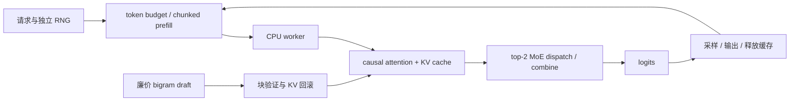

# nano-deepseek-infer

[中文](README.md) | [English](README.en.md)

**把 DeepInfer 风格的系统优化，拆成八个可运行、可对照、可追踪的 NumPy 实验。**

[](https://github.com/PeriodBLUE/nano-deepseek-infer/actions/workflows/test.yml)

中英 README · Python + NumPy · 无 GPU · 无权重下载 · 八个实验 + shape 导览 + 独立参考验证

> 独立教学项目，非 DeepSeek 官方项目。模型是随机初始化的单层 attention + top-2 MoE，输出没有学习过的语言含义。本项目复现可验证的机制与不变量，不加载 DeepSeek 权重，也不宣称复现其性能。

## 能力与资源矩阵

这个项目围绕一个学习目标组织代码：**验证改变缓存、草稿、专家放置和请求调度之后，哪些结果必须保持不变，以及额外工作量出现在哪里。**

CPU、无下载和数值测试并非本项目独有。我们的侧重点是 **用同一个 NumPy 小模型，观察系统状态变化、验证结果等价，同时记录收益与反例**。

**符号：✓ 已有实现／明确文档；✗ 明确不支持或不满足该列条件；— 本次未核实；✓\* 有条件支持，见脚注。** 不把“未核实”当“不支持”，也不将每个勾视为优势。对其他项目的判断来自 2026-10-21 的固定版本源码／文档核对，未做横向运行或性能测量。[逐项依据](docs/comparison.md)

### 运行条件与模型用途

| 项目 | CPU tiny 路径 | 仅 NumPy 运行时 | 默认 demo 不下载权重 | 训练后权重文本生成 |
|---|:---:|:---:|:---:|:---:|
| [Alexander-Qiu/nano-deepinfer](https://github.com/Alexander-Qiu/nano-deepinfer) | ✓ | ✗ | ✗¹ | ✓ |
| [singzhou/nano-deepseek-v4-inference](https://github.com/singzhou/nano-deepseek-v4-inference) | ✓ | ✗ | ✓ | ✗ |
| [hebo1221/nano-deepseek-v4](https://github.com/hebo1221/nano-deepseek-v4) | ✓ | ✗ | ✓ | ✓\*² |
| [GeeeekExplorer/nano-vllm](https://github.com/GeeeekExplorer/nano-vllm) | ✗ | ✗ | ✗ | ✓ |
| **本项目** | **✓** | **✓** | **✓** | **✗** |

¹ 默认示例下载 SmolLM2-135M；它另有不下载权重的 tiny 测试。² 指其自训练 native bundle 的文本生成，不表示加载了官方 DSpark checkpoint。

### 机制与验证范围

| 项目 | V4 架构组件 | 独立数值参考 | DSpark 方程验证 | 跨请求前缀复用 | 专家副本放置实验 |
|---|:---:|:---:|:---:|:---:|:---:|
| Alexander-Qiu/nano-deepinfer | ✗ | ✓ | — | — | — |
| singzhou/nano-deepseek-v4-inference | ✓\*³ | — | ✗ | — | — |
| hebo1221/nano-deepseek-v4 | ✓\*³ | ✓ | ✓\*⁴ | — | — |
| GeeeekExplorer/nano-vllm | — | — | — | ✓ | — |
| **本项目** | **✗** | **✓\*⁵** | **✗** | **✓\*⁶** | **✓\*⁷** |

³ tiny 参考结构，不代表官方权重／生产 kernel 对齐。⁴ CPU 方程与调度向量检查，不代表官方权重推测运行时。⁵ 独立控制流的 toy oracle，共享权重与 NumPy；不是第三方推理后端对照。⁶ 显式公共前缀、分支数组复制；无分页、自动匹配或驱逐。⁷ 单进程物理专家副本模拟，无真实多卡通信。

## 吸收了什么，已经落地什么

| 借鉴来源与优势 | 本项目已实现 | 验证方式与边界 |
|---|---|---|
| nano-deepinfer 的 Transformers 对照；hebo 的独立 oracle 与可记录验证结果 | [`verify`](nano_infer/verification.py)：独立逐 token attention/MoE 参考、版本与源码 SHA-256 记录 | 比较完整／分块前向，检出未来信息泄漏、位置丢失、MoE 遗漏三种故障；仅验证 toy 方程 |
| singzhou 的 shape 注释；hebo 的模型导览 | [`tour`](nano_infer/verification.py)：从实际执行收集 embedding、Q、KV、attention、MoE、logits 的 shape | 并排显示 prefill 与 decode；不是硬编码的架构示意 |
| nano-vLLM 的跨请求 prefix caching | [`demo prefix`](nano_infer/prefix.py)：公共前缀只算一次，KV 分支独立追加／回滚 | 与各请求完整重算逐 token 对比，并检查分支内存隔离；尚无分页块管理 |

这些实现保留仅 NumPy 的依赖范围。我们还保留草稿接受／回滚轨迹、冷启动控制器反例，以及到 DeepInfer 固定提交的[源码对应表](docs/upstream-map.md)。更完整的 V4 架构、真实 checkpoint 接入和 GPU 性能工程仍可沿比较表中的项目继续学习。

## 三分钟运行

Python 3.10+。Windows、Linux、macOS 均可使用，运行时依赖只有 NumPy。

```bash
git clone https://github.com/PeriodBLUE/nano-deepseek-infer.git
cd nano-deepseek-infer
python -m venv .venv
```

激活环境，任选对应的一行：

```bash
# Linux / macOS
source .venv/bin/activate
# Windows PowerShell
.\.venv\Scripts\Activate.ps1
```

```bash
python -m pip install -e .
python -m nano_infer demo all
python -m nano_infer tour
python -m nano_infer verify
python -m unittest discover -s tests -v
```

如果 PowerShell 禁止激活脚本，可以直接使用 `.\.venv\Scripts\python.exe` 代替 `python`，无需修改系统执行策略。

单独观察草稿接受／回滚和调度轨迹：

```bash
python -m nano_infer demo speculative --trace
python -m nano_infer demo scheduling --trace
python -m nano_infer demo all --json lesson-results.json
python -m nano_infer verify --json verification.json
python -m nano_infer tour --json shape-tour.json
python -m nano_infer generate --prompt "nano" --max-tokens 24
```

`generate` 的字符 tokenizer 仅支持小写英文字母、数字、空格及少量标点。中文说明不意味着这个随机小模型支持中文生成。安装后也可使用 `nano-infer` 命令。

## 八个实验，八个具体问题

| 实验 | 要回答的问题 | 本地实现与检查 |
|---|---|---|
| `cache` | 为什么 decode 不应重新计算整个前缀？ | 真实 Q/K/V 与因果 attention；有／无缓存生成 token 一致 |
| `prefix` | 不同请求的公共前缀能否只算一次？ | 复用前缀 KV，复制独立分支；与各请求完整重算一致 |
| `speculative` | 草稿错了怎么恢复？什么时候值得多猜几个？ | 一次块前向验证多个草稿；事务式回滚；固定预算与历史接受率预算对比 |
| `moe` | 热点专家导致的卡间失衡怎么缓解？ | top-2 路由、真实专家矩阵计算、复制／放置／分发／合并；结果数值一致 |
| `context` | 分开计算 softmax 的结果可以直接平均吗？ | 分片计算最大值、归一化常数与加权值，再合并；与完整 attention 比较 |
| `replay` | 只重放尾部有哪些严格前提？ | 单层 SWA，保留绝对位置及回滚余量；当前／回退位置和后续 decode 一致 |
| `scheduling` | 长 prompt 和短请求如何共同推进？ | token budget、chunked prefill、请求结束后退出批次、CPU lookahead、独立随机数流 |
| `structured` | 怎样让生成遵循格式约束？ | 对合法下一字符的 logits 做 mask；实际生成两种 JSON 候选之一 |

每个实验先执行正确性断言，再输出结果。记录：[实验结果](examples/results.json) · [实际 shape](examples/shape-tour.json) · [独立参考验证](examples/verification.json)。浮点误差的末位可能随 NumPy／BLAS 版本变化。验证记录包含 Python/NumPy 版本、源码摘要、四组输入及故障检出结果；这些摘要用于定位版本，不是签名或官方一致性认证。

这套默认配置的一次运行得到：

- **KV cache**：投影 token 数从 `708` 降到 `41`，输出 token 一致。这是工作量计数，不是墙钟加速倍数。
- **共享前缀**：三个请求共享 `29` 个 token 的前缀，投影 token 数从 `149` 降到 `91`，节省 `58` 次 token 投影；分支复制仍消耗内存和带宽。
- **固定长度草稿**：目标模型调用从 `48` 次降到 `26` 次，但投影 token 数从 `61` 增到 `156`。调用更少不代表 CPU 一定更快。
- **冷启动自适应草稿**：早期草稿质量差，预算降为零，目标调用 `49` 次。这一反例说明低质量草稿和不完善的控制器会增加开销。
- **MoE**：这批数据的两组模拟 rank 路由数从 `[80, 48]` 变为 `[66, 62]`，输出误差小于 `1e-12`。负载改善依赖输入分布。
- **尾部重放**：窗口 `8`、回滚余量 `3` 时，将这个单层模型的 prompt 重放从 `43` 个 token 缩至 `11` 个。

## 代码如何连起来



调度引擎和单请求推测解码是两个独立教学入口，共用 `TinyModel`。没有把推测解码强行塞进批次状态机，便于先分别证明正确性。

建议按以下顺序阅读：

1. [model.py](nano_infer/model.py)：一次前向怎样追加 KV，以及 prefill 和 decode 为什么是同一接口。
2. [decoding.py](nano_infer/decoding.py)：`pending` token、不接受后缀的回滚、请求独立采样。
3. [parallel.py](nano_infer/parallel.py)：逻辑专家与物理副本、分片 softmax 的合并。
4. [engine.py](nano_infer/engine.py)：等待队列、不可变工作计划、执行、提交输出。
5. [labs.py](nano_infer/labs.py) 与 [tests/test_core.py](tests/test_core.py)：每项设计能被什么实验推翻。
6. [verification.py](nano_infer/verification.py)、[prefix.py](nano_infer/prefix.py) 与 [新增测试](tests/test_verification.py)：独立参考、实际 shape 和公共前缀分支。

## 与 DeepInfer 的对应和边界

源码核对基于上游提交 [`774ce244b87cc0eb8d4b94ab9f5de2ab22049f01`](https://github.com/deepseek-ai/DeepInfer/tree/774ce244b87cc0eb8d4b94ab9f5de2ab22049f01)，核对日期为 2026-10-21。逐项文件／符号对应见 [源码导读](docs/upstream-map.md)。

| 上游设计 | nano 中保留的部分 | 明确省略的部分 |
|---|---|---|
| 优化 kernel、模型 runtime | 真正的 NumPy attention 和 MoE 数值计算 | MLA、稀疏 attention、FP8、融合 kernel、CUDA Graph |
| EP + EPLB | 逻辑／物理专家映射、热点复制、分发与合并 | 多进程、网络通信、在线权重迁移、多历史步优化 |
| balanced CP | softmax 跨分片的数值合并原理 | 上游 zigzag/mirror query 划分及真实 collective |
| DSpark / DFlash 与置信度调度 | greedy 草稿验证、回滚、历史预算控制 | 训练的 draft/confidence head、上游代际协议、随机推测采样 |
| SWA bounded replay | 单层局部依赖的尾部重放证明 | 完整 YoCo、跨层共享 cache、压缩与稀疏状态 |
| 异步调度 | worker 执行时准备其他就绪请求 | 同一请求提前一轮调度、GPU stream / event |
| batch invariance | 同一请求独立计算、独立 RNG；改变批次顺序仍输出一致 | 高效批量矩阵乘的跨 batch 位级一致性 kernel |
| structured output | 有限候选字符串的字符约束 | 通用 JSON Schema、regex、EBNF 编译器 |

这里的 “batch” 是调度批次，worker 内逐请求执行。EP／CP 的 rank 是单进程模拟。没有 HTTP 服务、分布式 KV cache 服务或多机部署入口。

进一步阅读：[设计推导](docs/design.md) · [动手练习](docs/exercises.md) · [完整英文 README](README.en.md)

## 测试与许可

20 项测试覆盖缓存／块计算等价、全接受／全拒绝、生成长度边界、回滚、热点专家副本、上下文分片、SWA 回退边界、批次顺序／大小／流水模式、EOS、缓存释放、前缀分支隔离与独立 oracle。GitHub Actions 配置 Windows/Linux × Python 3.10/3.12，并上传实验、shape 和验证结果。

本项目原创教学代码使用 [MIT License](LICENSE)。DeepInfer 的上游代码使用 Apache-2.0；此仓库通过链接提供来源，不包含其源码或权重。参见 [来源与致谢](NOTICE.md)。
