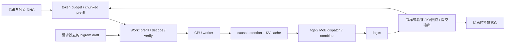

# nano-deepseek-infer

**[English](README.md)** | [简体中文](README.zh-CN.md)

**用一台普通电脑，从零跑通推理引擎的关键机制，沿源码讲清 DeepInfer 的设计与取舍。**

[](https://github.com/PeriodBLUE/nano-deepseek-infer/actions/workflows/test.yml)

面向初学者与推理工程求职者 · 中英双语 · 仅 NumPy · CPU 训练与文本生成

为什么生成一个 token 要读历史 KV？为什么多猜几个 token 有时反而更慢？为什么复制专家可以缓解负载，却不能随意更改路由结果？

从 [`infer.py`](infer.py) 开始：**请求陆续到达 → 分块 prefill → 调度草稿验证 → KV 提交/回滚 → 输出与释放。** 整条路径只依赖 NumPy，输出自动与全前缀重算对照。再用八个专题实验拆解细节，用 [`bench.py`](bench.py) 测量同一工作负载下的收益与成本，最后回到 DeepInfer 源码。

[开始运行](#三分钟运行) · [系统设计与面试导读](docs/interview-guide.md) · [DeepInfer 源码地图](docs/upstream-map.md) · [相关项目对比](#能力与资源矩阵)


## 三分钟运行

Python 3.10+。Windows、Linux、macOS 均可使用，运行时依赖只有 NumPy。

```bash
git clone https://github.com/PeriodBLUE/nano-deepseek-infer.git
cd nano-deepseek-infer
python -m venv .venv
```

激活环境，任选对应的一行：

```bash
# Linux / macOS
source .venv/bin/activate
# Windows PowerShell
.\.venv\Scripts\Activate.ps1
```

```bash
python -m pip install -e .
python -m nano_infer generate --checkpoint checkpoints/tiny-trained.npz --prompt "the model " --max-tokens 64
python infer.py
```

如果 PowerShell 禁止激活脚本，可以直接使用 `.\.venv\Scripts\python.exe` 代替 `python`，无需修改系统执行策略。

默认运行的一段输出如下；`r1` 在 `r0` 已经开始 decode 后到达。`input` 包括 pending 与草稿，`rollback` 表示本轮丢弃的 KV 条目。

```text
step request phase    input draft accept rollback cache     output
   1 r0      verify       5     4      0        4 4->5      '6'
  + r1: 'deepseek inference'
   2 r0      verify       5     4      0        4 5->6      'u'
   2 r1      prefill      3     0      0        0 0->3      ''
   3 r0      verify       5     4      4        0 6->11     'uuuuu'
   3 r1      prefill      3     0      0        0 3->6      ''
```

每次运行结束都检查输出等价与缓存释放。上面的固定种子示例便于观察状态；下面的训练权重路径使用同一套引擎生成文本。

**改一个参数，验证一个判断：**

```bash
python infer.py --draft-tokens 0
python infer.py --draft-tokens 4 --token-budget 3 --prefill-chunk 2
python infer.py --prompt "nano" --prompt "cache" --arrival-gap 1
python bench.py --repeats 5 --json benchmark.json
```

`bench.py` 固定输入、模型种子和输出长度，比较普通缓存、固定草稿、自适应草稿与流水草稿。每种策略先 warmup，再轮换顺序重复测量；报告 CPU 墙钟耗时、吞吐和工作量，保存原始样本、环境与源码摘要。计时包含引擎执行，不包含模型构造和正确性参考；**没有“优化必须更快”的断言**。

深入观察与验证：

```bash
python -m nano_infer tour
python -m nano_infer verify
python -m unittest discover -s tests -v
python -m nano_infer demo speculative --trace
python -m nano_infer demo scheduling --trace
python -m nano_infer demo all --json lesson-results.json
python -m nano_infer verify --json verification.json
python -m nano_infer tour --json shape-tour.json
python -m nano_infer generate --prompt "nano" --max-tokens 24
```

`generate` 的字符 tokenizer 仅支持小写英文字母、数字、空格及少量标点。训练语料为英文。安装后也可使用 `nano-infer` 命令。

## 训练权重，再用推理引擎生成文本

仓库附带 CPU 训练得到的 87,936 参数 attention + top-2 MoE 权重，可以直接加载；也可以从零训练全部参数，读懂每一步 NumPy 反向传播与 Adam 更新：

```bash
python -m nano_infer generate --checkpoint checkpoints/tiny-trained.npz --prompt "the model " --max-tokens 64
python infer.py --checkpoint checkpoints/tiny-trained.npz --prompt "the model " --max-tokens 64 --json trained-trace.json
python train.py
python bench.py --checkpoint checkpoints/tiny-trained.npz --repeats 5 --json trained-benchmark.json
python infer.py --checkpoint artifacts/tiny-trained.npz --prompt "the model " --max-tokens 64
python -m nano_infer.dspark --json dspark.json
```

[`train.py`](train.py) 串起 next-character loss、causal attention/MoE 梯度、裁剪、Adam、留出集评估、保存/重载与生成。[`data/`](data/) 提供原创英文训练文本及独立留出文本。[训练记录](examples/training.json)、[训练权重推理轨迹](examples/trained-inference.json)与[训练权重基准](examples/trained-benchmark.json)可直接查看。训练记录包含配置、loss、生成样本与数据/权重摘要；[训练导读](docs/training.md) 解释张量、路由梯度与评估。字符词表支持小写英文及部分标点。

**DSpark 同样可以运行：** [方程实验](docs/dspark.md) 覆盖特征投影/RMSNorm、Markov logits、归一化前置信度、逐步温度和双代际调度。24 组 head 张量与独立标量方程对照，80 组预算与分配案例通过穷举参考验证。每个候选预算的预期 token、graph bucket、耗时和吞吐都可查看。

## 跑通完整的推理系统链路

```bash
python systems.py --json systems.json
python infer.py --checkpoint checkpoints/tiny-trained.npz --batched --kv-blocks 64 --prompt "the model " --prompt "the cache " --max-tokens 32
python bench.py --checkpoint checkpoints/tiny-trained.npz --batched --repeats 5
python load_test.py --requests 8 --json service-load.json
python serve.py --checkpoint checkpoints/tiny-trained.npz
```

| 核心设计 | 可运行实现 | 面试时能讲清的问题 |
|---|---|---|
| **真正的 batching** | padding 后的批量 Q/K/V 和 attention、请求独立绝对位置 mask、有效行 MoE | 调度 batch 和矩阵 batch 有何区别？padding 为什么增加成本？ |
| **分页 KV 所有权** | 块表、free list、引用计数、COW 尾块、容量原子检查；最长前缀 LRU 索引 | 共享、回滚、驱逐、请求释放如何相互作用？ |
| **DeepSeek-V2 MLA** | 展开 KV 参考与吸收矩阵后的 latent cache attention，解耦 RoPE | 推导缓存节省，并解释哪些矩阵乘法移动了位置 |
| **可调用的 HTTP 服务** | 有界准入、FIFO 排队、KV 预留、增量轮询、取消、超时、故障恢复 | 从入队到终态，请求占用了什么资源，什么时候释放？ |
| **逐请求延迟** | HTTP 负载脚本记录排队、TTFT、ITL、TPOT、百分位与原始时间 | 区分服务提交延迟、客户端吞吐和推测解码突发输出 |

[逐项设计与 API 导读](docs/systems.md) · [数值与内存结果](examples/systems.json) · [HTTP 负载结果](examples/service-load.json) · [批量引擎轨迹](examples/batched-inference.json) · [批量基准](examples/batched-benchmark.json)

数值样例中 latent KV 为 1,632 字节，展开为 7,072 字节，输出误差低于 `1e-12`；batch 样例将 11 个有效 query 作为 15 行 padding 数据完成一次前向。节省与执行成本都有具体计数。

## 这个项目能帮你掌握什么

| 学习优势 | 你能具体做到 | 从哪里开始 |
|---|---|---|
| **从训练到服务的完整链路** | 推导梯度、训练权重、重载 checkpoint，经同一缓存/调度器生成文本 | [`train.py`](train.py) · [训练导读](docs/training.md) |
| **DSpark 从公式到决策** | 解释 norm 前置信度、Markov 递推与代际隔离的预算选择 | [DSpark 实验](docs/dspark.md) · [独立参考](nano_infer/dspark_reference.py) |
| **一条完整的请求主线** | 改动请求到达时机与草稿预算，观察同一调度器中的 prefill、验证、回滚和结束 | [`infer.py`](infer.py) · [`Engine`](nano_infer/engine.py) |
| **每个概念都能看见** | 对照 prefill / decode 的实际 shape，逐轮检查草稿接受、KV 回滚与批次变化 | `tour` · `demo speculative --trace` · `demo scheduling --trace` |
| **优化有可检验的理由** | 说明改变执行方式后哪些输出必须不变，定位因果 mask、位置编码、缓存分支的错误 | `verify` · [正确性检查](docs/interview-guide.md#7-如何证明优化没有改变答案) |
| **性能判断有收益，也有成本** | 比较同输入、同输出下的 CPU 耗时、调用次数与投影工作，判断优化何时不划算 | [`bench.py`](bench.py) · [性能分析](docs/interview-guide.md#8-面试中的性能问题怎么回答) |
| **能从小模型走回生产源码** | 找到 DeepInfer 的调度、EPLB、DSpark、YoCo 和 sampler 入口，指出教学机制到生产实现还差什么 | [源码地图](docs/upstream-map.md) · [进阶路线](docs/interview-guide.md#9-走向-deepinfer-与完整模型实现) |

## 学完后，你能带着哪些成果去面试

你可以从 loss 一直解释到训练权重生成文本；逐轮推导 prefill/decode 与 KV 所有权；讲清 DSpark 的 head 和预算公式；用控制变量实验说明一次推理优化的收益与成本。每项收获都有代码入口、运行命令与结果记录。

| 调研的官方岗位 | 本项目对应练习 | 可以展示的成果 |
|---|---|---|
| Anthropic — Inference Engine | batching、缓存状态、确定性 | 到达/回滚/释放 trace 与故障回归测试 |
| OpenAI — Inference Performance Optimization | 工作负载与成本分析 | CPU benchmark、DSpark 候选成本曲线 |
| NVIDIA — Inference Performance Engineer | KV、MoE、推测解码与受控实验 | 工作量、专家负载及输出一致性检查 |
| Together AI — ML Engineer, Inference | runtime 接入、可靠性与工具 | 训练→checkpoint→引擎、异常路径测试 |

[官方 JD 链接、能力验收表与面试成果清单](docs/career-map.md)（2026-10-21 核对）。按清单整理自己的模型、引擎、内存与 HTTP 服务测量结果。

## 从第一次运行到能讲清设计

不要求先读完整个仓库。按下面顺序，每一步都产出一份自己可以解释的证据。

| 阶段 | 运行与阅读 | 你应该能独立回答 |
|---|---|---|
| 1. 看懂一次前向 | `tour`、`demo cache`；读 `model.py` | 为什么 prefill 的 score 是 `4×4`，下一步 decode 是 `1×5`？KV 保存了什么？ |
| 2. 看懂请求状态 | `python infer.py`；读 `engine.py`；再运行 `demo prefix` | 晚到请求怎样进入正在运行的引擎？token budget 如何约束草稿？哪些状态属于请求？ |
| 3. 讲清执行优化 | `demo speculative --trace`、`demo moe`、`demo context`、`demo replay` | 每项优化省什么、增加什么、依赖什么前提？被拒绝的草稿为何不能留在 KV 中？ |
| 4. 拿出验证证据 | `python bench.py`、`verify`、测试与[动手练习](docs/exercises.md) | 正确性通过后，优化是否真的降低了耗时？哪些结论仍需 GPU 测量？ |
| 5. 组织系统设计回答 | [面试导读](docs/interview-guide.md) → [固定版本上游源码](docs/upstream-map.md) | 如何把模型、引擎、kernel 和服务层连起来，并指出各自负责的问题？ |

## 八个实验，八个具体问题

| 实验 | 要回答的问题 | 本地实现与检查 |
|---|---|---|
| `cache` | 为什么 decode 不应重新计算整个前缀？ | 真实 Q/K/V 与因果 attention；有／无缓存生成 token 一致 |
| `prefix` | 不同请求的公共前缀能否只算一次？ | 复用前缀 KV，复制独立分支；与各请求完整重算一致 |
| `speculative` | 草稿错了怎么恢复？什么时候值得多猜几个？ | 一次块前向验证多个草稿；事务式回滚；固定预算与历史接受率预算对比 |
| `moe` | 热点专家导致的卡间失衡怎么缓解？ | top-2 路由、真实专家矩阵计算、复制／放置／分发／合并；结果数值一致 |
| `context` | 分开计算 softmax 的结果可以直接平均吗？ | 分片计算最大值、归一化常数与加权值，再合并；与完整 attention 比较 |
| `replay` | 只重放尾部有哪些严格前提？ | 单层 SWA，保留绝对位置及回滚余量；当前／回退位置和后续 decode 一致 |
| `scheduling` | 长 prompt 和短请求如何共同推进？ | token budget、chunked prefill、请求结束后退出批次、CPU lookahead、独立随机数流 |
| `structured` | 怎样让生成遵循格式约束？ | 对合法下一字符的 logits 做 mask；实际生成两种 JSON 候选之一 |

每个实验先执行正确性断言，再输出结果。记录：[实验结果](examples/results.json) · [实际 shape](examples/shape-tour.json) · [独立参考验证](examples/verification.json)。浮点误差的末位可能随 NumPy／BLAS 版本变化。验证记录包含 Python/NumPy 版本、源码摘要、四组输入及故障检出结果；这些摘要用于定位版本，不是签名或官方一致性认证。

这套默认配置的一次运行得到：

- **KV cache**：投影 token 数从 `708` 降到 `41`，输出 token 一致。这是工作量计数，不是墙钟加速倍数。
- **共享前缀**：三个请求共享 `29` 个 token 的前缀，投影 token 数从 `149` 降到 `91`，节省 `58` 次 token 投影；分支复制仍消耗内存和带宽。
- **固定长度草稿**：目标模型调用从 `48` 次降到 `26` 次，但投影 token 数从 `61` 增到 `156`。调用更少不代表 CPU 一定更快。
- **冷启动自适应草稿**：早期草稿质量差，预算降为零，目标调用 `49` 次。这一反例说明低质量草稿和不完善的控制器会增加开销。
- **MoE**：这批数据的两组模拟 rank 路由数从 `[80, 48]` 变为 `[66, 62]`，输出误差小于 `1e-12`。负载改善依赖输入分布。
- **尾部重放**：窗口 `8`、回滚余量 `3` 时，将这个单层模型的 prompt 重放从 `43` 个 token 缩至 `11` 个。

## 代码如何连起来



`Engine(max_draft=4)` 将 greedy 草稿验证纳入调度批次，草稿也占用 token budget；每个请求独立保存 draft、历史预算与 KV。`add_request()` / `step()` 允许轮次间提交新请求，`run()` 提供离线与 CPU 流水入口。单请求 `speculative()` 保留为专题实验，与引擎共用 `greedy_prefix()` 验证规则。

建议按以下顺序阅读：

1. [infer.py](infer.py)：完整驱动循环，输入与输出都在这里。
2. [engine.py](nano_infer/engine.py)：入队 → 规划 → 执行 → 提交/回滚 → 释放。
3. [model.py](nano_infer/model.py) 与 [decoding.py](nano_infer/decoding.py)：数值前向和草稿验证。
4. [bench.py](bench.py) 与 [引擎测试](tests/test_engine.py)：固定工作负载、真实耗时与状态边界。
5. [parallel.py](nano_infer/parallel.py)、[labs.py](nano_infer/labs.py) 与 [prefix.py](nano_infer/prefix.py)：并行与前缀共享专题。
6. [systems.py](systems.py)、[serve.py](serve.py)、[load_test.py](load_test.py)：数据打包、物理内存所有权与请求生命周期。
7. [verification.py](nano_infer/verification.py)：独立参考和实际 shape。[设计取舍与参考项目](docs/nano-design.md)解释为什么保留这些边界。

## 能力与资源矩阵

本项目把 **CPU 训练、权重文本生成、可逐步追踪的请求引擎、DSpark 方程验证与受控性能实验** 放进同一套 NumPy 代码，读者可以沿同一条路径理解模型、状态与成本。

**符号：✓ 已有实现／明确文档；✗ 明确不支持或不满足该列条件；— 本次未核实；✓\* 有条件支持，见脚注。** 不把“未核实”当“不支持”，也不将每个勾视为优势。对其他项目的判断来自 2026-10-21 的固定版本源码／文档核对，未做横向运行或性能测量。[逐项依据](docs/comparison.md)

### 运行条件与模型用途

| 项目 | CPU tiny 路径 | 仅 NumPy 运行时 | 默认 demo 不下载权重 | 训练后权重文本生成 |
|---|:---:|:---:|:---:|:---:|
| [Alexander-Qiu/nano-deepinfer](https://github.com/Alexander-Qiu/nano-deepinfer) | ✓ | ✗ | ✗¹ | ✓ |
| [singzhou/nano-deepseek-v4-inference](https://github.com/singzhou/nano-deepseek-v4-inference) | ✓ | ✗ | ✓ | ✗ |
| [hebo1221/nano-deepseek-v4](https://github.com/hebo1221/nano-deepseek-v4) | ✓ | ✗ | ✓ | ✓\*² |
| [GeeeekExplorer/nano-vllm](https://github.com/GeeeekExplorer/nano-vllm) | ✗ | ✗ | ✗ | ✓ |
| **本项目** | **✓** | **✓** | **✓** | **✓** |

¹ 默认示例下载 SmolLM2-135M；它另有不下载权重的 tiny 测试。² 指其自训练 native bundle 的文本生成，不表示加载了官方 DSpark checkpoint。

### 机制与验证范围

| 项目 | V4 架构组件 | 独立数值参考 | DSpark 方程验证 | 跨请求前缀复用 | 专家副本放置实验 |
|---|:---:|:---:|:---:|:---:|:---:|
| Alexander-Qiu/nano-deepinfer | ✗ | ✓ | — | — | — |
| singzhou/nano-deepseek-v4-inference | ✓\*³ | — | ✗ | — | — |
| hebo1221/nano-deepseek-v4 | ✓\*³ | ✓ | ✓\*⁴ | — | — |
| GeeeekExplorer/nano-vllm | — | — | — | ✓ | — |
| **本项目** | **✗** | **✓\*⁵** | **✓\*⁸** | **✓\*⁶** | **✓\*⁷** |

³ tiny 参考结构，不代表官方权重／生产 kernel 对齐。⁴ CPU 方程与调度向量检查，不代表官方权重推测运行时。⁵ 独立控制流的 toy oracle，共享权重与 NumPy；不是第三方推理后端对照。⁶ 数组复制基线，以及分页最长前缀 LRU 索引、引用计数与 COW（`systems.py`）。⁷ 单进程物理专家副本模拟，无真实多卡通信。


⁸ 特征投影/RMSNorm、Markov logits、归一化前 confidence 与逐步温度、双代际预算分配；标量与穷举参考对照。[方程与证据](docs/dspark.md)。

## 与 DeepInfer 的对应和边界

源码核对基于上游提交 [`774ce244b87cc0eb8d4b94ab9f5de2ab22049f01`](https://github.com/deepseek-ai/DeepInfer/tree/774ce244b87cc0eb8d4b94ab9f5de2ab22049f01)，核对日期为 2026-10-21。逐项文件／符号对应见 [源码导读](docs/upstream-map.md)。

| 上游设计 | nano 中保留的部分 | 明确省略的部分 |
|---|---|---|
| 优化 kernel、模型 runtime | NumPy attention/MoE、ragged batch；独立的 V2 MLA 权重吸收实验 | V4 专用稀疏 attention、FP8、融合设备 kernel、CUDA Graph |
| EP + EPLB | 逻辑／物理专家映射、热点复制、分发与合并 | 多进程、网络通信、在线权重迁移、多历史步优化 |
| balanced CP | softmax 跨分片的数值合并原理 | 上游 zigzag/mirror query 划分及真实 collective |
| DSpark / DFlash 与置信度调度 | 特征投影、Markov/confidence 方程、N−2 预算与最新代际分配、独立参考；引擎内 greedy 回滚 | draft decoder 训练、GPU 执行与随机推测采样 |
| SWA bounded replay | 单层局部依赖的尾部重放证明 | 完整 YoCo、跨层共享 cache、压缩与稀疏状态 |
| 异步调度 | worker 执行时准备其他就绪请求 | 同一请求提前一轮调度、GPU stream / event |
| batch invariance | 同一请求独立计算、独立 RNG；改变批次顺序仍输出一致 | 高效批量矩阵乘的跨 batch 位级一致性 kernel |
| structured output | 有限候选字符串的字符约束 | 通用 JSON Schema、regex、EBNF 编译器 |

`--batched` 将调度工作打包成真正的批量矩阵计算，逐请求路径保留为数值基线。`serve.py` 连接批量执行、分页请求缓存和 HTTP 生命周期管理。EP／CP 的 rank 仍是单进程模拟。[系统导读](docs/systems.md)解释每个接口和测量口径。

进一步阅读：[系统设计与面试导读](docs/interview-guide.md) · [设计推导](docs/design.md) · [动手练习](docs/exercises.md) · [完整英文 README](README.md)

## 测试与许可

40 项测试覆盖数值等价与引擎状态，包括草稿中的 EOS、极小 token budget、晚到请求、执行失败后清理、跨流水模式的输出一致，全参数梯度、checkpoint 重载、DSpark 方程、分页 COW/驱逐、batch mask、MLA、HTTP 生命周期及独立 oracle。GitHub Actions 配置 Windows/Linux × Python 3.10/3.12，并上传完整推理轨迹、CPU 基准、专题实验、shape、训练 smoke run、DSpark、内存/batching 实验及 HTTP 负载结果。

本项目原创教学代码使用 [MIT License](LICENSE)。DeepInfer 的上游代码使用 Apache-2.0；此仓库通过链接提供来源，不包含其源码或权重。参见 [来源与致谢](NOTICE.md)。
