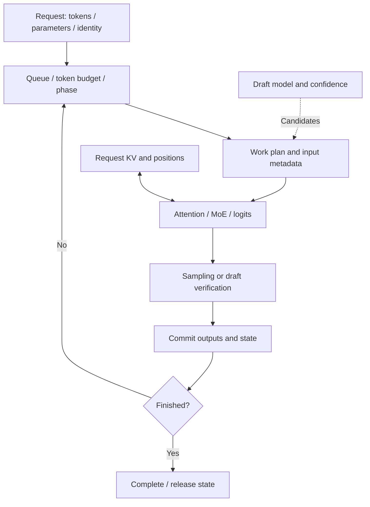

# Explain DeepInfer through one request: system design and interview guide

[English](interview-guide.en.md) | [中文](interview-guide.md) | [README](../README.en.md)

Build an explanation you can draw, execute and follow into source code. For each topic, use **problem → state and data flow → correctness → cost → upstream implementation**. Confidence comes from answering follow-ups: what changed, why it remains correct, when it loses and how to measure that.

Run commands from the repository root. Local mechanisms execute in NumPy; upstream mechanisms require following pinned source. The labs establish an inference-engine perspective. Full DeepSeek architecture, device kernels and distributed services remain further areas of study.

## 1. Draw the system boundary

The model specifies the computation; the engine organizes requests, state and execution.

| Layer | Responsibility | Local entry point |
|---|---|---|
| Model | Tokens, hidden states, attention, expert outputs and logits | `TinyModel.forward`: one attention layer and top-2 MoE |
| Engine | Which requests run, which tokens they consume, when state and outputs commit | `Request`, `Work`, `Engine._plan/_execute/_finish` |
| Device execution | Matrix and attention kernels, communication, precision and overlap | NumPy calculations; single-process EP/CP simulations |
| Service | Admission, rate limits, replica routing, cache services, disaggregation and monitoring | System-design exercises; no network service here |

This is the engine data flow. Run `python infer.py` to observe draft verification and prefill sharing execution plans. Model and device execution remain at teaching scale.



The reviewed [DeepInfer release](https://github.com/deepseek-ai/DeepInfer/blob/774ce244b87cc0eb8d4b94ab9f5de2ab22049f01/README.md) targets DeepSeek-V4.1-Flash. It provides offline inference and core engine capabilities; a complete service still needs a KV cache system, disaggregation and routing across DP replicas. This distinguishes service infrastructure from the engine's internal KV reads and writes.

## 2. Follow one request

Run `python infer.py --draft-tokens 0` for ordinary generation, then `python infer.py` for verification inside the same engine. Read [engine.py](../nano_infer/engine.py).

| Stage | Entry | State transition |
|---|---|---|
| Admission | `add_request` | Create request-local RNG, cache and prompt cursor; enter the ready queue |
| Planning | `_plan` | Produce immutable `Work` within token, request-count and prefill-chunk limits |
| Execution | `_execute` | Forward the selected tokens and append their K/V |
| Commit | `_finish` | Advance the cursor; sample after prefill or verify drafts and roll back; append outputs |
| Continue or stop | `_finish` | Requeue unfinished requests; release cache on EOS or the output limit |

**Work through an example.** For prompt `nano` and chunk size 2, round one consumes `na`: cursor and cache length become 2, with no output. Round two consumes `no`: both become 4, and the last logits row produces `y0`. Round three consumes `y0`: cache length becomes 5, and logits produce `y1`.

An emitted token does not acquire K/V until its next forward pass. The final output needs no further pass when the request ends. Chunking a long prompt creates opportunities to schedule other requests between chunks.

`infer.py` calls `add_request()` between rounds so the second request arrives later. `run()` is a convenience API for simultaneous admission. In speculative mode, pending and all candidates consume the token budget. Output limits and EOS constrain committed history; EOS inside an accepted draft must stop output immediately.

**Does a scheduling batch mean parallel arithmetic?** Here the worker executes each request separately. A production engine must also pack requests into device tensors and metadata. Follow upstream [`LLMEngine.step`](https://github.com/deepseek-ai/DeepInfer/blob/774ce244b87cc0eb8d4b94ab9f5de2ab22049f01/deepinfer/engine/llm_engine.py) and [`scheduler.hpp`](https://github.com/deepseek-ai/DeepInfer/blob/774ce244b87cc0eb8d4b94ab9f5de2ab22049f01/csrc/engine/scheduler.hpp).

## 3. Explain prefill, decode and KV with shapes

Run `python -m nano_infer tour`. Default width is 24 and vocabulary size is 45.

| Tensor | Prefill: `nano` | Decode: first output token |
|---|---|---|
| New embeddings / Q | `[4, 24]` | `[1, 24]` |
| Cached K and V, each | `[4, 24]` | `[5, 24]` |
| Attention scores | `[4, 4]` | `[1, 5]` |
| Logits | `[4, 45]` | `[1, 45]` |

Both use `forward(new_tokens, cache)`; the new query length changes. Each logits row predicts the **next token**. A chunk's causal mask must include historical positions as well as the new block.

**Why does caching work?** With fixed weights and positions, historical K/V in a causal model do not depend on future tokens. Decode avoids projecting old tokens again, although the new query still reads its visible KV. `demo cache` checks cached/uncached outputs and counts projections and score elements.

**How much memory?** Local K/V arrays use `2Tdb` bytes for length T, width d and b bytes per element; default float64 means b=8. This excludes weights, temporary scores and allocation peaks. General multi-layer models require accounting for layers, KV heads and head dimensions. Compressed KV, windows and cross-layer sharing require their actual layouts.

**Within-request caching versus cross-request reuse:** `demo prefix` computes a common prefix once and copies independent branches. For R requests sharing P tokens, it saves `(R−1)P` projections but still copies memory. A paged extension needs block identity, reference counts, writable tails/copy-on-write, eviction and compatible model/position/prefix state.

## 4. Speculation: verify several tokens in one pass

Run `python -m nano_infer demo speculative --trace`; read [decoding.py](../nano_infer/decoding.py).

A cheap draft proposes candidates; a causal target forward verifies their contiguous prefix. At each round:

```text
Known history = cached tokens + pending
The target has not processed pending yet
```

Let the old cache length be L and drafts be `[a, b, c]`. The target consumes `[pending, a, b, c]`. Logits row 0 verifies a; row 1 verifies b. If a matches and b does not:

1. Emit a and correction r from row 1's argmax.
2. Truncate cache to `L+2`, retaining the old cache, pending and a.
3. Make r the next pending token. Discard b and c's KV.

When all drafts match, emit them and a bonus token from the final row. The bonus remains pending. Accepting a drafts adds `1+a` cache entries and emits `1+a` tokens. **The cache stores input history; output contains successor predictions. Equal lengths do not mean identical token contents.**

**Why preserve the answer?** Only a contiguous prefix matching target argmax is accepted. After a mismatch, later rows condition on the wrong history. With correct masking and positions, and numerical errors that do not change argmax, outputs should match sequential greedy decoding. Stochastic speculation additionally needs proposal distributions and acceptance/residual sampling.

**Why not always draft more?**

```text
Expected progress = 1 + Σ_i P(first i candidates all accepted)
Efficiency ≈ expected progress / (draft time + verification time + state handling)
```

The local controller approximates this using historical acceptance and artificial cost. Default fixed drafts reduce target calls from 48 to 26 but increase projected tokens from 61 to 156. The adaptive example exposes a cold-start failure: it stops drafting and has no exploration mechanism.

Upstream [`DFlash / ConfidenceHead`](https://github.com/deepseek-ai/DeepInfer/blob/774ce244b87cc0eb8d4b94ab9f5de2ab22049f01/deepinfer/model_executor/models/mtp/dflash.py) and [`MTPVarlen::schedule`](https://github.com/deepseek-ai/DeepInfer/blob/774ce244b87cc0eb8d4b94ab9f5de2ab22049f01/csrc/engine/mtp_varlen.hpp) add trained heads, confidence-history isolation, runtime curves and batch budgets. Track which historical round each decision may read.

## 5. Parallelism: partition, then combine

| Common dimension | What is partitioned | Cost and consistency questions |
|---|---|---|
| DP | Requests or attention work across replicas/groups | Request routing, KV ownership and replica balance |
| TP | Matrix or feature dimensions | Partial-result reduction and communication cost |
| CP | Context tokens / attention work | Causal imbalance, visible KV and softmax merging |
| EP | Expert weights and execution | Dispatch/combine, hotspots and communication |

This is a general taxonomy. The reviewed DeepInfer README specifically lists Attention DP / balanced CP and MoE EP + EPLB; this table is not a claim that every configuration is implemented.

**Logical experts determine the function; physical copies determine placement.** In `demo moe`, the router selects top-2 logical experts. Tokens go to copies with identical weights, execute their MLPs and combine using routing weights. EPLB changes placement without changing the logical selection. Example simulated rank loads change from `[80,48]` to `[66,62]`.

Copies cost memory; placement changes can require migration; dispatch costs communication; historical hotspots may change. Upstream [`eplb/policy.py`](https://github.com/deepseek-ai/DeepInfer/blob/774ce244b87cc0eb8d4b94ab9f5de2ab22049f01/deepinfer/model_executor/eplb/policy.py) considers multiple historical steps, while the local example uses aggregate loads.

**Do not average locally normalized attention outputs.** For each shard j, collect maximum score `m_j`, normalization sum `z_j` and weighted-value sum `n_j`. Rescale with global maximum m:

```text
m = max_j m_j
output = Σ_j exp(m_j−m) n_j / Σ_j exp(m_j−m) z_j
```

`demo context` compares this with full attention. Balanced CP adds another question: later causal queries see more tokens, so equal token partitions need not mean equal work. Upstream query layouts and communication require further study.

## 6. Three state dependencies to watch

**Visibility and replay.** `demo replay` proves a single-layer SWA case: preserve window W plus rollback allowance B, and retain absolute positions. Default `W=8,B=3` reduces replay from 43 tokens to 11. In a multi-layer network, later K/V depend on earlier hidden states; arbitrary suffix truncation is not justified. Follow YoCo producer/consumer and shared-cache paths through the [source map](upstream-map.md).

**Execution and asynchronous planning.** While worker A runs, the local scheduler prepares B for other ready requests. In-flight requests remain out of the ready queue until commit. Same-request lookahead requires identifying metadata that can be prepared early, token-dependent state, and synchronization/correction rules. Adding a thread alone does not eliminate scheduling overhead.

**Request identity, numerical execution and sampling.** Request-local RNG prevents other requests from consuming its random stream. Different batch reductions or kernels may still change logits. Determinism involves both arithmetic and RNG state. Local fixed per-request execution verifies reorder invariance; efficient batch-invariant kernels solve an additional problem upstream.

`demo structured` masks illegal next characters before sampling. Grammar state is also request-local. The local language contains just two JSON candidates; production handling must relate tokenizer tokens to grammar transitions.

## 7. Prove that an optimization preserves results

Run `python -m nano_infer verify` and `python -m unittest discover -s tests -v`.

| Possible error | Check | What it establishes |
|---|---|---|
| Full and cached paths share a bug | Compare with token-wise/expert-wise reference | Reference avoids `TinyModel.forward` and runtime softmax |
| Future leakage, lost positions or missing MoE | Inject three reference-path faults and require detection | Fixtures are sensitive to those specified errors |
| Incorrect rollback or output limits | Full acceptance, full rejection, length limits and multiple seeds | Exercise state branches a normal example may miss |
| Cross-request KV or RNG interference | Branch isolation, request order, batch size and pipeline comparisons | Request identity survives execution changes |
| Partition/placement changes the function | Full versus sharded attention; before/after expert placement | Numerical checks support combine semantics |

The reference shares weights and NumPy. It reduces shared control-flow mistakes, but cannot exclude shared specification errors or establish official-model parity. Reports include inputs, tolerance, runtime versions and source digests.

For each implementation, present **a working case, a boundary and a change that should fail**. For example, explain why removing `offset` breaks replay positions.

## 8. Answer performance questions

Declare measurement boundaries first. With client-side timestamps:

- **TTFT:** request submission to first output token, potentially including network, queueing, prefill and first-token processing.
- **Mean TPOT:** time from first to last received token divided by `output tokens−1`; undefined for a single-token output. Individual intervals reveal jitter.
- **Throughput:** completed output tokens per time in a specified window; state treatment of input tokens, warmup and unfinished requests.

Prefill generally exposes more token parallelism, while per-request decode queries are short. Avoid claiming that prefill is always compute-bound or decode always bandwidth-bound: context, batches, expert distributions, devices, communication and kernels change the bottleneck.

| Observation | Initial hypothesis | Evidence to collect |
|---|---|---|
| Long prompts increase first-token waits | Queueing or long prefill execution slices | Queue/execute time, chunk size, arrival and length distributions |
| Drafting reduces calls but increases latency | Draft cost, wasted verification or inefficient execution shapes | Total and draft/verify timings, accepted-prefix distribution |
| Some MoE ranks repeatedly wait | Expert hotspots or communication tails | Per-rank token counts, compute and communication time |
| High prefix-hit rate with large memory use | Copied branches, private tails or retention policy | Allocated blocks, references, peak memory and evictions |

Fix model revision, hardware, precision, arrival/length distributions, sampling and concurrency. Warm up, repeat measurements, report percentiles and memory, and validate correctness first. Track both latency and throughput when changing chunk, batch or draft budgets.

Run `python bench.py --repeats 5 --json benchmark.json` to compare measured CPU time and work across four policies on one workload. It includes warmup, rotated measurement order, raw samples and output checks. Its p95 is the sample quantile of complete run durations.

Local projection, score and rank counters explain work; CPU events show scheduling order. Neither these nor CPU timings substitute for GPU latency or distributed throughput. Use profiling to test bottleneck hypotheses.

## 9. Continue into DeepInfer and model architecture

The following entries are pinned to `774ce244`. Build a concrete reading artifact at each step.

| Question | Upstream entry | Artifact to produce |
|---|---|---|
| How do configuration and shared topology construct a model? | [`v4_modules/builder.py`](https://github.com/deepseek-ai/DeepInfer/blob/774ce244b87cc0eb8d4b94ab9f5de2ab22049f01/deepinfer/model_executor/models/v4_modules/builder.py) | Relationships among main blocks, prediction heads, DFlash heads and sharing |
| How does dense attention generalize to actual cache layouts? | [`v4_modules/attn.py`](https://github.com/deepseek-ai/DeepInfer/blob/774ce244b87cc0eb8d4b94ab9f5de2ab22049f01/deepinfer/model_executor/models/v4_modules/attn.py) | Trace projections, RoPE, compressed KV, sparse indices, SWA and storage for a selected configuration |
| How do attention, MoE and residual state connect? | [`decoder_layer.py`](https://github.com/deepseek-ai/DeepInfer/blob/774ce244b87cc0eb8d4b94ab9f5de2ab22049f01/deepinfer/model_executor/models/decoder_layer.py) | Locate mHC-related entries and sublayer inputs/outputs, then enter those modules |
| How does engine metadata control execution? | [`llm_engine.py`](https://github.com/deepseek-ai/DeepInfer/blob/774ce244b87cc0eb8d4b94ab9f5de2ab22049f01/deepinfer/engine/llm_engine.py) and [source map](upstream-map.md) | Schedule → execute → post-process call chain with state ownership |
| Where do experts, drafting, YoCo and sampling enter? | [File and symbol map](upstream-map.md) | Dependencies, commit timing, numerical checks and costs for each optimization |
| How does math become device execution? | [Upstream kernel list](https://github.com/deepseek-ai/DeepInfer/blob/774ce244b87cc0eb8d4b94ab9f5de2ab22049f01/README.md) | Select an actual call, trace layout/precision and kernel I/O, then measure it |

Separate architecture mechanisms, architecture-specific optimizations and general engine mechanisms. Ordinary Q/K/V, sinusoidal absolute positions and softmax top-2 routing here are not V4 attention, RoPE, routing or mHC. State which DeepSeek version and system layer you are explaining.

## 10. Turn the work into your own project explanation

Use this **90-second structure** only after personally running and checking the experiments:

> I studied an inference engine using a NumPy-only model. Requests pass through token-budget and chunked-prefill scheduling. The worker processes new tokens, appends KV, samples outputs and commits state. I focused on correctness under optimization: speculative decoding commits only a contiguous accepted prefix and rolls back rejected state; expert balancing changes physical placement without changing logical routing. The experiments expose tradeoffs too: fixed drafts reduce target calls while increasing projection work. I then mapped these mechanisms to DeepInfer's scheduler, EPLB and DSpark entries to examine costs on real devices.

For five minutes, cover the request lifecycle, one numerical state example, correctness evidence, a benefit/cost pair and an upstream connection with a proposed next experiment.

Mark these ✓ or ✗ after checking yourself:

| Can explain independently? | Task | Completion criterion |
|:---:|---|---|
| □ | Draw the lifecycle | Identify owners of cursor, KV, last output, RNG and completion |
| □ | Work through prefill/decode | Write actual shapes and locate the logits row producing the first token |
| □ | Work through draft rejection | Identify retained/discarded tokens, new cache length and next pending |
| □ | Explain one distributed mechanism | Explain expert-copy equivalence or softmax merging, including communication costs |
| □ | Present a counterexample | Explain cold-start drafting failure or the multi-layer replay limitation |
| □ | Make your own extension | Add exploration, changing hotspots or latency-aware admission policies; retain baseline and verification |
| □ | Follow one upstream entry | Trace the call chain and distinguish executed evidence from source inspection |

Accurately distinguish what you ran and analyzed, what you independently implemented and what you read. Identifying an unimplemented component and proposing a falsifiable next step is also part of system-design competence.

## Training, DSpark and job requirements

[Training walkthrough](training.md) connects gradients, weights and serving; [DSpark equations](dspark.md) derive Markov/confidence heads and generation-separated allocation. Use the [official JD mapping](career-map.en.md) to organize your own experiments and interview evidence.
