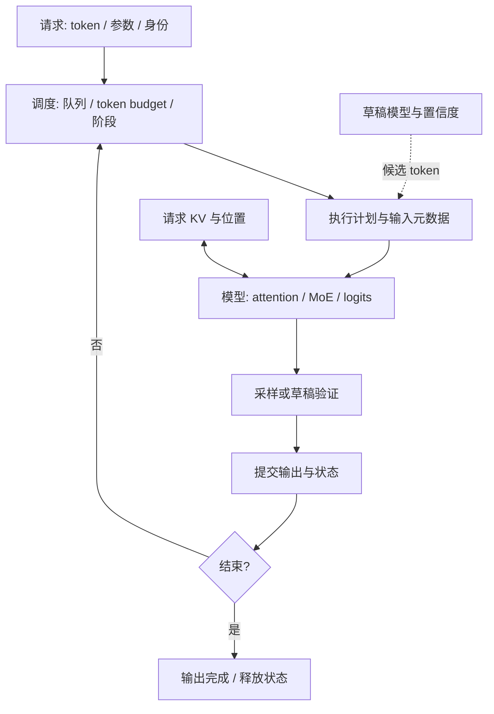

# 从一次请求讲清 DeepInfer：系统设计与面试导读

[中文](interview-guide.md) | [English](interview-guide.en.md) | [回到 README](../README.md)

这份导读帮助你形成一套能画出来、跑出来、沿源码追下去的解释。建议每个主题都按 **问题 → 状态与数据流 → 正确性 → 成本 → 上游实现** 来讲。面试中的信心来自能够接住追问：改了什么、为什么正确、什么情况下不划算、如何测出来。

文中的命令在仓库根目录执行。标为“本地”的机制可以在 NumPy 代码中运行；标为“上游”的部分需沿固定版本源码继续阅读。完成本地实验能建立推理引擎的系统视角；完整 DeepSeek 模型结构、设备 kernel 与多机服务需要后续专项学习。

## 1. 先画系统边界

“DeepSeek 模型”决定要计算什么，“DeepInfer 引擎”决定怎样组织计算、状态和设备执行。讲设计时先把四层分开，再说明接口。

| 层次 | 核心职责 | 本项目中的抓手 |
|---|---|---|
| 模型 | token 如何变成隐藏状态、attention、专家输出和 logits | `TinyModel.forward`：单层 attention + top-2 MoE |
| 推理引擎 | 哪些请求本轮执行、输入哪些 token、KV 如何更新、输出何时提交 | `Request`、`Work`、`Engine._plan/_execute/_finish` |
| 设备执行 | 矩阵计算、attention kernel、分片通信、低精度与执行重叠 | NumPy 数值实验；EP/CP 在单进程模拟 |
| 服务 | 接入、限流、跨副本路由、缓存服务、分离部署与监控 | 通过系统设计题练习；本仓库无网络服务 |

下面是引擎的数据流。运行 `python infer.py` 可观察调度器如何将草稿验证与 prefill 放入同一执行计划；默认模型和设备执行仍是教学规模。



所核对的 [DeepInfer 发布说明](https://github.com/deepseek-ai/DeepInfer/blob/774ce244b87cc0eb8d4b94ab9f5de2ab22049f01/README.md) 面向 DeepSeek-V4.1-Flash，提供离线推理与核心引擎能力；完整服务仍需 KV cache 系统、分离部署和跨 DP 副本负载均衡。这不表示引擎内部没有 KV 读写，而是服务系统与模型运行时承担不同职责。

## 2. 沿着一次请求读实现

先运行 `python infer.py --draft-tokens 0` 看普通生成，再用 `python infer.py` 看同一引擎中的草稿验证。对照 [engine.py](../nano_infer/engine.py)：

| 时刻 | 代码入口 | 请求状态怎样变化 |
|---|---|---|
| 提交 | `add_request` | 为每个请求建立独立 RNG、KV 和 prompt cursor；进入 ready 队列 |
| 规划 | `_plan` | 在 token budget、最大请求数和 prefill chunk 限制内生成不可变 `Work` |
| 执行 | `_execute` | 对本轮输入 token 前向，将 K/V 追加到该请求的 cache |
| 提交 | `_finish` | 更新 prompt cursor；完整 prompt 后采样，或验证草稿并回滚；追加输出 |
| 继续或退出 | `_finish` | 未完成请求回到队列；达到 EOS 或长度上限后释放 KV |

**手推一个例子。** prompt 为 `nano`，chunk 为 2。第一轮输入 `na`：cursor 从 0 变 2、cache 长度为 2，不生成输出。第二轮输入 `no`：cursor 变 4、cache 长度为 4，从最后一行 logits 采样首个输出 `y0`。第三轮输入 `y0`：cache 长度变 5，产生 `y1`。

这说明“已经输出的 token”和“已经写入 KV 的 token”不总相同。刚采样出的 token 要到下一次前向才有 K/V；最后一个输出若直接结束，就无需再前向。长 prompt 分块后，调度器才有机会在轮次之间服务其他请求。

`infer.py` 在轮次之间调用 `add_request()`，让第二个请求晚到；`run()` 则是所有请求同时提交的便利接口。推测模式下，pending 和所有候选都占用 token budget；输出长度和 EOS 在提交时约束真正保留的历史。EOS 即使在接受的草稿中间，也必须立即截断输出。

**常见追问：批处理等于并行计算吗？** 本项目把多个请求安排进同一计划，worker 内仍逐请求执行。生产引擎还要把请求打包为设备可执行的张量与元数据。上游从 [`LLMEngine.step`](https://github.com/deepseek-ai/DeepInfer/blob/774ce244b87cc0eb8d4b94ab9f5de2ab22049f01/deepinfer/engine/llm_engine.py) 进入，再跟到 [`scheduler.hpp`](https://github.com/deepseek-ai/DeepInfer/blob/774ce244b87cc0eb8d4b94ab9f5de2ab22049f01/csrc/engine/scheduler.hpp)。

## 3. 用张量讲清 prefill、decode 与 KV

运行 `python -m nano_infer tour`。默认宽度为 24、字符词表大小为 45：

| 张量 | Prefill：输入 `nano` | Decode：输入首个输出 token |
|---|---|---|
| 新 token embedding / Q | `[4, 24]` | `[1, 24]` |
| 已缓存 K 与 V，各自 | `[4, 24]` | `[5, 24]` |
| attention score | `[4, 4]` | `[1, 5]` |
| logits | `[4, 45]` | `[1, 45]` |

同一个 `forward(new_tokens, cache)` 接口，区别在于新 query 的长度。每行 logits 预测该位置的**下一个 token**。分块前向的 causal mask 必须同时处理已有前缀和当前块：不能只在当前块内做一个三角 mask 而忘记历史位置。

**KV 为什么有效？** 固定模型与位置后，因果模型旧 token 的 K/V 不依赖未来 token，因而可以复用。Decode 省去重复投影旧 token 的工作，但新 query 仍要访问其可见范围内的 KV。`demo cache` 验证 cached/uncached 输出一致，并统计重复投影和 score 元素数。

**KV 占多少内存？** 对本项目，长度 T、宽度 d、每元素 b 字节，K/V 数组占 `2Tdb`；默认 float64 的 b=8。这不含权重、临时 score 或数组扩容峰值。普通多层多头模型要再按层、KV head 和 head dimension 计数；压缩 KV、SWA 和跨层共享则必须依据实际布局重新计算。

**跨请求共享与请求内缓存有什么不同？** `demo prefix` 为公共前缀算一次 KV，然后复制独立分支。R 个请求共享 P 个 token，可少做 `(R−1)P` 次 token 投影，但仍复制内存。若扩展为分页共享，应处理块身份、引用计数、可写尾块与 copy-on-write、驱逐，以及模型/位置/前缀是否完全匹配；这些是后续实现任务。

## 4. 推测解码：一次验证为何能推进多个 token

运行 `python -m nano_infer demo speculative --trace`，阅读 [decoding.py](../nano_infer/decoding.py)。

草稿模型先低成本提出候选；目标模型利用一次因果块前向验证候选的连续前缀。每轮开始时：

```text
已知历史 = cache 中的 token + pending
pending 尚未经过目标前向
```

假设旧 cache 长度为 L，草稿为 `[a, b, c]`。目标输入 `[pending, a, b, c]`，第 0 行 logits 验证 a，第 1 行验证 b。若 a 正确、b 错误：

1. 输出 a 和第 1 行 argmax 得到的修正 token r。
2. cache 截断到 `L+2`，只新增 pending 与 a。
3. r 成为下一轮 pending；b、c 的 KV 必须丢弃。

若三个都接受，则输出 a、b、c 和最后一行预测的 bonus token；bonus 也留待下一轮前向。一般地，接受 a 个草稿时，cache 增加 `1+a`，输出也增加 `1+a`。**KV 的内容是输入历史，输出是其后继预测；长度相同不代表 token 内容相同。**

**为什么不破坏答案？** 这里只接受与目标 argmax 一致的连续前缀；一旦失配，后续 logits 基于错误历史，不能再拿来输出。因果 mask、位置正确且浮点误差未改变 argmax 时，结果应与逐步 greedy 一致。随机推测采样还需要提议分布与接受/残差采样，不能靠“两个采样 token 一样”判断正确性。

**草稿越长越好吗？** 需要比较单位时间推进的期望 token 数：

```text
期望推进 = 1 + Σ_i P(前 i 个候选全部被接受)
候选策略的效率 ≈ 期望推进 / (draft 时间 + verify 时间 + 状态处理时间)
```

本项目控制器用历史接受统计与人工成本近似这个目标。默认固定草稿把目标调用从 48 降到 26，但投影 token 从 61 增到 156；差草稿可能增加工作。自适应控制器还展示了冷启动后停止探索的失败案例。

上游的 [`DFlash / ConfidenceHead`](https://github.com/deepseek-ai/DeepInfer/blob/774ce244b87cc0eb8d4b94ab9f5de2ab22049f01/deepinfer/model_executor/models/mtp/dflash.py) 和 [`MTPVarlen::schedule`](https://github.com/deepseek-ai/DeepInfer/blob/774ce244b87cc0eb8d4b94ab9f5de2ab22049f01/csrc/engine/mtp_varlen.hpp) 进一步涉及训练的预测头、置信度历史隔离、runtime 曲线与批次预算。读这两处时，追问“当前决策能读取哪一轮统计”，避免把未来验证结果偷用到预算选择中。

## 5. 并行设计：先说切什么，再说怎样合并

| 常见并行维度 | 分什么 | 要解释的成本与一致性问题 |
|---|---|---|
| DP | 请求或 attention 工作分到不同副本/组 | 请求路由、KV 所属与副本负载 |
| TP | 矩阵或特征维度 | 部分结果如何归约，通信是否抵消计算收益 |
| CP | 同一上下文的 token/attention 工作 | 因果工作量不均、KV 可见域与 softmax 合并 |
| EP | 不同专家的权重与执行 | token dispatch/combine、热点专家与跨设备通信 |

这是通用分类；所核对的 DeepInfer README 特别列出 Attention DP / balanced CP 与 MoE EP + EPLB。不能把该表当作所有配置均已实现的功能表。

**MoE 的关键区分：逻辑专家决定函数，物理副本决定执行地点。** 在 `demo moe` 中，router 先选 top-2 逻辑专家，再把 token 分配给拥有相同权重的物理副本，执行 MLP，按路由权重合并。EPLB 可调整副本与位置，保持逻辑选择不变。这批数据的模拟 rank 负载从 `[80,48]` 变为 `[66,62]`。

追问“复制越多越好吗”：副本占显存，更新放置涉及权重迁移，分发涉及通信，历史热点也可能变化。上游 [`eplb/policy.py`](https://github.com/deepseek-ai/DeepInfer/blob/774ce244b87cc0eb8d4b94ab9f5de2ab22049f01/deepinfer/model_executor/eplb/policy.py) 使用多个历史步，nano 的聚合负载只是入门模型。

**CP 的关键区分：局部归一化的 attention 输出不能直接平均。** 对每个分片 j 记录最大 score `m_j`、归一化和 `z_j`、加权值和 `n_j`，再用全局最大值 m 重标定：

```text
m = max_j m_j
output = Σ_j exp(m_j−m) n_j / Σ_j exp(m_j−m) z_j
```

`demo context` 把这个结果与完整 attention 对照。下一步再解释 balanced CP：因果 attention 中后面 query 可见的 token 更多，平均切 token 未必平均切工作；上游的 query 布局与通信还有额外实现要求。

## 6. 三类容易被忽略的状态依赖

**窗口依赖与尾部重放。** `demo replay` 只对一层 SWA 证明：保留窗口 W 加回退余量 B，并保存绝对位置，可覆盖回退边界与后续 decode 的依赖。默认 `W=8,B=3`，重放长度从 43 变为 11。多层网络后层 K/V 还依赖前层隐藏状态，不能直接套用这个截断法。上游 YoCo 的 producer/consumer 与共享 cache 要沿[源码地图](upstream-map.md)单独追踪。

**执行依赖与异步调度。** 本项目在 worker 执行 A 时为其他就绪请求规划 B；A 的请求从 ready 移除，提交前不能再调度。要扩展为同一请求的提前调度，必须明确哪些元数据可以预先构造、哪些依赖尚未产生的 token，以及如何同步/修正。不能把“加一个线程”当作消除了所有调度开销。

**请求身份、数值路径与采样状态。** 每个请求独立 RNG，才能避免其他请求消耗其随机数流；不同 batch 的归约和 kernel 也可能改变 logits。确定性需要同时考虑数值执行与随机数状态。本地逐请求固定计算路径可验证批次重排不改变结果；高性能批量 kernel 的一致性是上游额外解决的问题。

`demo structured` 展示在采样前屏蔽非法下一字符。约束状态也属于请求；本地语法仅两个有限 JSON 候选。生产版要处理 tokenizer token 与语法状态之间的映射，不能等生成完再把非法字符串“修一下”当作同一种机制。

## 7. 如何证明优化没有改变答案

运行 `python -m nano_infer verify` 和 `python -m unittest discover -s tests -v`。

| 要排除的错误 | 检查方式 | 为什么有说服力 |
|---|---|---|
| 完整前向与缓存路径共享同一个错误 | 与独立逐 token/逐 expert 参考比较 | 参考不调用 `TinyModel.forward` 或运行时 softmax |
| 看了未来、丢了位置、漏了 MoE | 在参考路径注入三种故障，要求差异被检出 | 说明这些 fixture 对指定错误敏感 |
| 回滚长度或输出边界错误 | 全接受、全拒绝、长度上限和多 seed 测试 | 正常输出示例不足以覆盖状态分支 |
| 请求之间串 KV 或 RNG | 分支隔离、请求重排、批次大小和流水模式对照 | 执行环境改变时，请求身份仍应稳定 |
| 切分/复制改变函数 | 完整 attention 与分片比较；专家放置前后比较 | 用数值误差验证合并语义 |

参考实现共享权重与 NumPy；它降低控制流重复出错的风险，但不能排除共同的规格错误，也不能证明官方模型一致。验证输出附输入、容差、运行时版本和源码摘要，使每个结论可定位到一次具体运行。

讲自己的实现时，应能给出 **一个成立的例子、一个边界、一个会失败的改动**。例如：解释 `offset` 后，指出删除它会使尾部重放的位置错位；不要只背“KV cache 优化了速度”。

## 8. 面试中的性能问题怎么回答

先声明测量口径。例如采用客户端时间：

- **TTFT**：发出请求到收到第一个输出 token。可能包含网络、排队、prefill 与首 token 处理。
- **平均 TPOT**：收到首 token 到最后一个 token 的时间差除以 `输出 token 数−1`；单 token 请求不适用。逐 token 间隔还能观察抖动。
- **吞吐**：固定测量窗口内完成的输出 token 数/时间；需要说明是否含输入 token、warmup 和未完成请求。

Prefill 往往有更多 token 可并行，decode 的单请求 query 较短，但“prefill 永远算力瓶颈、decode 永远带宽瓶颈”过于绝对。上下文、batch、专家分布、硬件、通信与 kernel 都会改变瓶颈。

| 现象 | 首先提出的假设 | 需要补充的证据 |
|---|---|---|
| 长 prompt 到来后首 token 等待增加 | 排队或 prefill 占用了较长执行片段 | 排队/执行时间、chunk 大小、请求到达与长度分布 |
| 开启草稿后调用更少却更慢 | 验证浪费、draft 成本或执行形状不合适 | 总耗时、接受前缀分布、draft/verify 分项时间 |
| MoE 某些 rank 总在等待 | 专家热点或通信拖尾 | 各 rank 专家 token 数、计算时间、通信时间 |
| 前缀命中率高却显存仍很大 | 复制分支、未共享尾块或缓存保留策略 | 实际分配块、引用数、峰值内存和驱逐记录 |

完整实验应固定模型版本、硬件、精度、请求到达/长度分布、采样参数与并发，做 warmup、多次测量、报告分位数与内存，并先验证正确性。改 chunk、batch 或草稿预算时，同时观察吞吐和请求延迟。

运行 `python bench.py --repeats 5 --json benchmark.json`，比较同一工作负载下四种策略的真实 CPU 耗时与工作量。脚本包含 warmup、轮换测量顺序、原始样本和输出等价检查；报告的 p95 是多次完整运行耗时的样本分位数。

本项目的 `projected_tokens`、`score_elements` 与 rank 计数可以解释工作量，CPU 事件可以观察调度顺序；这些及 CPU 耗时不能替代 GPU 延迟或多机吞吐测量。实际优化建议应以 profile 验证假设。

## 9. 走向 DeepInfer 与完整模型实现

把本地问题映射回上游，按下面路径补齐完整实现视角。链接固定到 `774ce244`；名称与结构以该版本为准。

| 接下来要弄清什么 | 上游入口 | 阅读时产出什么 |
|---|---|---|
| 模型怎样由配置组装，哪些层共享状态 | [`v4_modules/builder.py`](https://github.com/deepseek-ai/DeepInfer/blob/774ce244b87cc0eb8d4b94ab9f5de2ab22049f01/deepinfer/model_executor/models/v4_modules/builder.py) | 主模型 block、预测头、DFlash 头及共享拓扑的关系图 |
| 从 dense attention 走向真实 KV 布局 | [`v4_modules/attn.py`](https://github.com/deepseek-ai/DeepInfer/blob/774ce244b87cc0eb8d4b94ab9f5de2ab22049f01/deepinfer/model_executor/models/v4_modules/attn.py) | 逐配置追踪投影、RoPE、压缩 KV、稀疏索引、SWA 与读写位置 |
| 模型层怎样连接 attention、MoE 与残差状态 | [`decoder_layer.py`](https://github.com/deepseek-ai/DeepInfer/blob/774ce244b87cc0eb8d4b94ab9f5de2ab22049f01/deepinfer/model_executor/models/decoder_layer.py) | 标出 mHC 相关入口及每个子层的输入输出；再进入对应模块 |
| 引擎元数据如何影响模型执行 | [`llm_engine.py`](https://github.com/deepseek-ai/DeepInfer/blob/774ce244b87cc0eb8d4b94ab9f5de2ab22049f01/deepinfer/engine/llm_engine.py) 与[源码地图](upstream-map.md) | schedule → execute → post-process 的调用链，标记状态所有者 |
| 专家、草稿、YoCo 与采样如何进入链路 | [按文件与符号排列的源码地图](upstream-map.md) | 为每条优化写出依赖、提交时机、数值检查和成本 |
| 数学计算如何落到设备 | [上游 README 的 kernel 列表](https://github.com/deepseek-ai/DeepInfer/blob/774ce244b87cc0eb8d4b94ab9f5de2ab22049f01/README.md) | 选一个实际调用，追张量布局、精度与 kernel 输入输出，再测量 |

尤其要区分**架构机制、架构专用优化和通用引擎机制**。本地普通 Q/K/V、正弦绝对位置和 softmax top-2 MoE，并不等于 V4 的 attention、RoPE、路由或 mHC。解释“DeepSeek 的设计”时，应说清正在讨论哪个版本和哪一层，而不是把不同代模型的术语拼在一起。

## 10. 把学习结果变成自己的项目讲述

**90 秒主线**可以这样组织；其中实验结论应在你亲自运行并核对之后使用：

> 我用一个仅依赖 NumPy 的小模型研究推理引擎。请求先经过 token budget 和分块 prefill 调度，worker 只为新 token 计算并追加 KV，再采样、提交输出和处理结束。我重点追踪优化后的状态是否仍然正确：例如推测解码只提交连续接受的草稿，并回滚错误后缀；专家负载均衡改变物理放置而不改变逻辑路由。实验还展示了性能取舍：固定草稿减少目标调用，却增加投影工作量。最后我把这些机制对应到 DeepInfer 的调度器、EPLB 和 DSpark 入口，继续分析真实设备上的成本。

如果被要求讲五分钟，可把时间分给：请求主线 → 一个带数字的状态推演 → 正确性测试 → 一个收益与代价 → 上游对应与下一步实验。

面试前用下面的表自测。按右列标准完成任务后，在左列填写 ✓ 或 ✗。

| 已能独立解释？ | 自测任务 | 完成标准 |
|:---:|---|---|
| □ | 画出请求生命周期 | 标出 cursor、KV、最后一个输出、RNG 和结束条件的所有者 |
| □ | 手算一次 prefill 与 decode | 写出实际 shape，解释首 token 从哪一行 logits 产生 |
| □ | 手算一次草稿拒绝 | 写出保留/丢弃的 token、cache 新长度和下轮 pending |
| □ | 解释一个分布式机制 | 讲清 EP 的副本等价或 CP 的归一化合并，并列出通信成本 |
| □ | 展示一个反例 | 解释冷启动草稿失败或多层模型不能直接套 SWA 后缀规则 |
| □ | 做一个自己的扩展 | 完成[探索预算、热点变化或晚到请求延迟练习](exercises.md)，保留基线和验证结果 |
| □ | 回读一个上游入口 | 从文件/符号追出调用链，明确自己运行验证和源码阅读各覆盖什么 |

这张表可自行标 ✓ 或 ✗。能讲清尚未实现的部分、提出可验证的下一步，也是系统设计能力的一部分。介绍项目时准确区分“运行并分析了”“独立实现了”“阅读过源码”，让每个说法都有证据。
