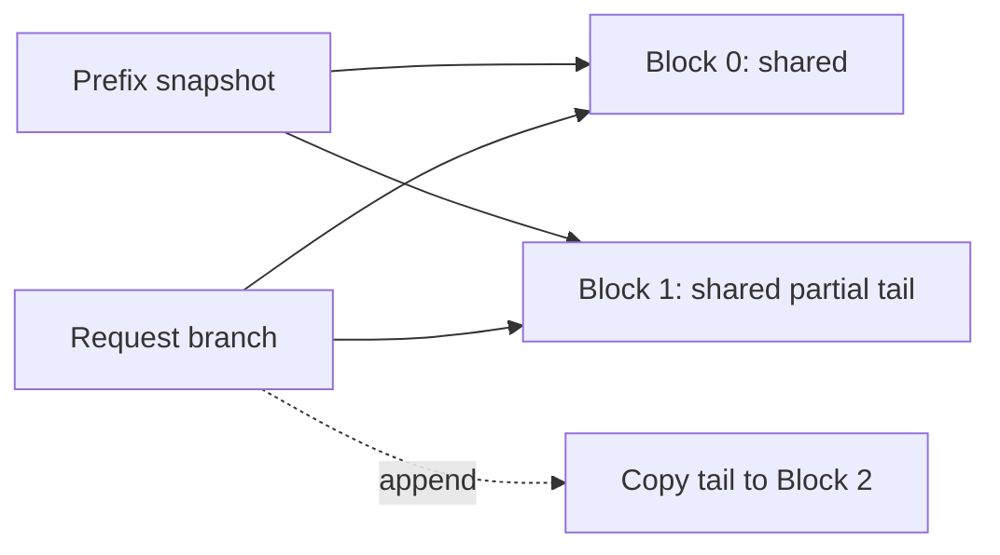
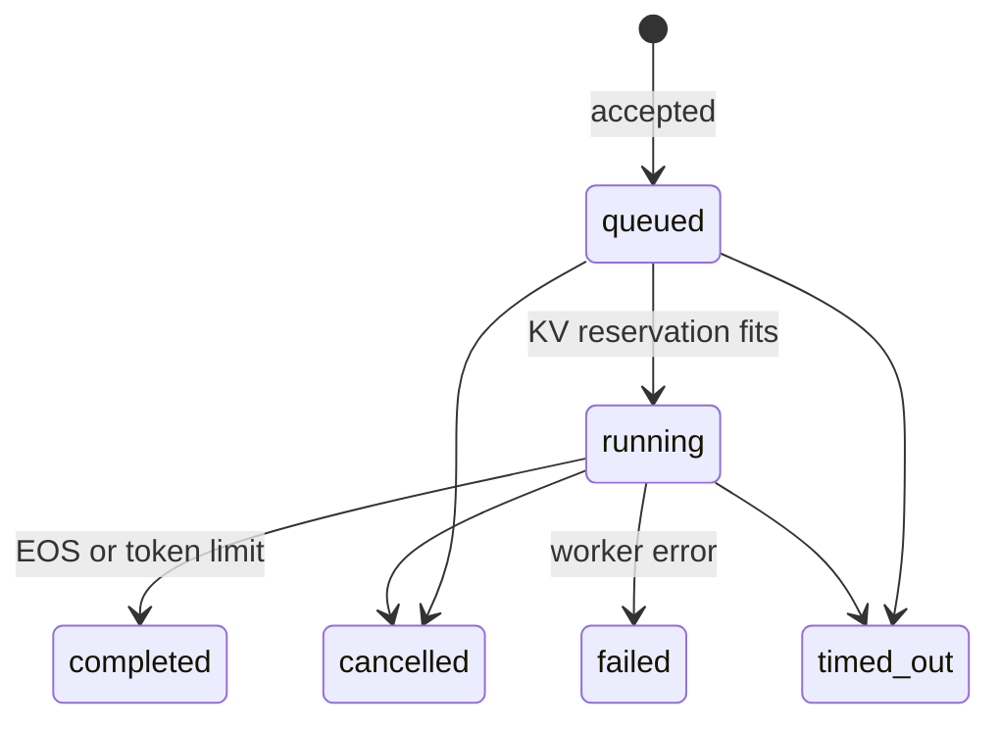

# From tensors to a serving system

[English](systems.en.md) | [简体中文](systems.md) | [Home](../README.md)

This chapter follows four implementation questions that frequently expose gaps in an interview explanation. Each has executable code, a counterexample and a checked result.

```bash
python systems.py --json systems.json
python infer.py --checkpoint checkpoints/tiny-trained.npz --batched --kv-blocks 64 --prompt "the model " --prompt "the cache " --max-tokens 32
python bench.py --checkpoint checkpoints/tiny-trained.npz --batched --repeats 5
python load_test.py --requests 8 --json service-load.json
```

## 1. What makes a batch real?

`Engine._plan()` chooses work. `TinyModel.forward_batch()` packs it and performs batched matrix multiplication. These are separate responsibilities: a scheduler's list alone does not vectorize execution.

For B requests, maximum new-query length Q and maximum cached length K:

| Tensor | Shape | Meaning |
|---|---|---|
| Token IDs, positions, live-query mask | `[B,Q]` | Only live queries emit outputs |
| Projected Q and new K/V | `[B,Q,D]` | Projection includes padded rows |
| Gathered historical K/V | `[B,K,D]` | Each request occupies its own batch row |
| Attention scores and visibility | `[B,Q,K]` | Causality uses absolute positions, not padded indices |
| Live MoE inputs | `[sum(query_lengths),D]` | Padded queries never enter routing |

A key is visible only if it is real, belongs to that request, and its position is no later than the query; SWA adds its lower bound. Padded query rows get one dummy visible key to keep softmax finite, then their outputs are discarded. Changing batch membership can change floating-point reduction order, so tests compare logits within tolerance and greedy outputs exactly across the fixtures.

The runnable example uses query lengths `[1,5,5]`: **11 live tokens, 15 projected rows, one batched forward**. That padding overhead is recorded as actual work. `bench.py --batched` uses the same prompt/output workload as the per-request baseline and includes paged-KV gather cost. Fewer Python calls alone cannot establish a speedup.

Read [forward_batch](../nano_infer/model.py), then [mask and engine tests](../tests/test_systems.py). Try tracing a query whose request starts at nonzero cache offset; the test already covers it.

## 2. Who owns a shared KV block?

`BlockPool` owns fixed arrays `[physical_blocks, block_size, width]` for K and V. A `PagedCache` owns a logical block table and visible length. Physical blocks have reference counts; a freed block goes back to a free list.



Forking increments counts and copies only the block table. Appending into a shared partial tail first copies that physical block. Otherwise one request could overwrite another's history. Rollback reduces visible length and releases whole suffix blocks; appending after rollback must still perform copy-on-write if the retained tail is shared. A complete append preflights capacity before mutating any table or data.

`PrefixStore` performs longest exact token-prefix lookup with bounded LRU eviction. Its snapshots belong to one fixed model and position scheme. Evicting the index entry drops only that reference: a live branch still owns its blocks. Reusing the store across weight updates would be incorrect. The pool test evicts a snapshot while a branch is alive, then compares that branch's continuation with full recomputation.

The example holds a five-token prefix in **two four-token blocks**, shared by two branches and the store. Each branch appends into its partial tail, causing two COW copies. Releasing branches and clearing the store returns all blocks.

Three different byte counts matter:

- Reserved NumPy pool storage: `2 × physical_blocks × block_size × width × 8`.
- Live physical blocks: `2 × used_blocks × block_size × width × 8`.
- Logical tokens: sum of request-visible lengths; shared tokens may appear in several logical counts.

The model gathers paged blocks into dense arrays for NumPy attention. Gather buffers and padded attention scores add temporary memory. Pool size therefore measures KV storage, not total process RSS.

The HTTP engine uses paged private request caches. Shared-prefix lookup/COW is exercised by `systems.py` through the same cache interface; the HTTP adapter does not automatically index incoming prompts. [paging.py](../nano_infer/paging.py) and its tests expose both ownership paths explicitly.

## 3. What does compressed KV actually change?

[mla.py](../nano_infer/mla.py) implements the latent-cache and weight-absorption equations from [DeepSeek-V2 §2.1.1](https://arxiv.org/abs/2405.04434). This is the V2 MLA architecture lesson; the pinned DeepInfer runtime elsewhere in this project targets V4.1. Keep those versions distinct in an interview.

For one head, content keys and values are projections of a shared latent C:

$$K_C=CW_{UK},\qquad V=CW_{UV}.$$

Instead of expanding all cached keys, absorb the key projection into the query:

$$Q_CK_C^T=(Q_CW_{UK}^T)C^T.$$

After softmax, aggregate latents before the value projection:

$$\operatorname{softmax}(S)V=(\operatorname{softmax}(S)C)W_{UV}.$$

The score also contains the dot product of the query and shared key's decoupled RoPE channels. Position rotation stays in that separate channel; applying it indiscriminately to the content keys would obstruct the simple absorption above. The score scale is `sqrt(content_dim + rotary_dim)`.

Both paths execute in the lab: expanded K/V is the algebraic reference; the incremental path retains only latent C and rotated positional keys. For 17 tokens, 4 heads, content/value width 6, latent width 8 and rotary width 4, float64 cache storage is **7,072 bytes expanded versus 1,632 bytes compressed**. The expanded count includes a shared rotary key once. The fixture's output error is below `1e-12`.

This is a storage-versus-compute tradeoff: latent attention changes projection and reduction shapes. Cache-byte reduction is measurable here; hardware speed needs profiling. Tests cover causality, chunked prefill, single-token decode and multiple seeds.

## 4. How does an engine become a service?

`Service` adds a bounded waiting queue and terminal records around `Engine`; `serve.py` adds HTTP and an owner lock. The worker alone advances model state. HTTP calls submit/cancel between steps, so an in-flight forward cannot race a cache release.



Before admitting a request, the engine conservatively reserves enough blocks for prompt, requested output and maximum draft scratch. Blocks are physically allocated on demand. Reserving the lifetime maximum prevents a batch of partially decoded requests from exhausting memory with no request able to finish. It trades utilization for a short, inspectable admission rule. FIFO waiting makes this head-of-line blocking visible.

Queue saturation returns HTTP 429. A single request larger than total KV capacity returns 400 immediately. Cancellation, timeout, normal completion and worker failure all release request blocks and reservations. Deadlines are cooperative at step boundaries; an already-running forward completes before cleanup. Partial committed output remains inspectable. Terminal records and traces have bounded retention.

### Run and call the server

```bash
python serve.py --checkpoint checkpoints/tiny-trained.npz --port 8000
```

| Method | Path | Request / result |
|---|---|---|
| POST | `/requests` | `{"prompt":"the model ","max_tokens":32,"timeout":30}` → 202 with `id` |
| GET | `/requests/{id}` | Status, incremental text/token IDs, error and metrics |
| DELETE | `/requests/{id}` | Cancel queued/running work; completed work stays completed |
| GET | `/health` | Service status and physical KV pool counters |

`python load_test.py --url http://127.0.0.1:8000 --requests 8` exercises the network path. Without `--url`, the command starts a temporary local server, validates completed outputs against the bundled checkpoint's full recomputation and closes the server.

### Name the latency you measured

| Metric | Definition in this implementation |
|---|---|
| Queue time | Engine admission − service submission |
| TTFT | First output commit − service submission |
| ITL | Difference between adjacent output-token commit times |
| TPOT | Mean ITL for a request with at least two output tokens |
| Completion latency | Terminal transition − service submission |
| Client throughput | Completed output tokens / client elapsed time, including HTTP and staggered arrivals |

Server timing begins when the service accepts the parsed submission. It excludes earlier network and HTTP-lock wait. Speculative tokens committed together share a timestamp, so some ITLs are zero; that is a burst, not infinitely fast decoding. Polling can observe the burst later. The load test saves raw per-request results and scheduled/actual send times, plus empirical p50/p95/p99. Eight requests demonstrate the measurement path; percentiles from a tiny run are not a stable SLO estimate.

Evidence: [systems results](../examples/systems.json), [HTTP load results](../examples/service-load.json), [systems tests](../tests/test_systems.py). You can now explain the model calculation, packed execution, memory ownership, admission decision and observed request latency from the same repository.
