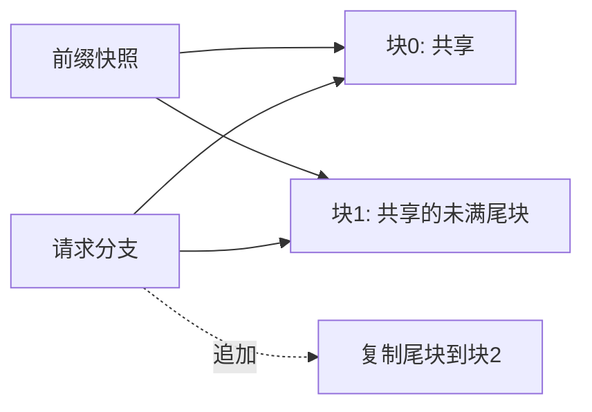

# 从张量计算到推理服务

[English](systems.en.md) | [简体中文](systems.md) | [首页](../README.zh-CN.md)

本章把四个容易在面试追问中断开的环节连起来。每一节都有实现、反例和可运行结果。

```bash
python systems.py --json systems.json
python infer.py --checkpoint checkpoints/tiny-trained.npz --batched --kv-blocks 64 --prompt "the model " --prompt "the cache " --max-tokens 32
python bench.py --checkpoint checkpoints/tiny-trained.npz --batched --repeats 5
python load_test.py --requests 8 --json service-load.json
```

## 1. 什么才是真正的 batch？

`Engine._plan()` 决定执行哪些工作，`TinyModel.forward_batch()` 打包数据并执行批量矩阵乘。调度器返回一个列表，与模型真正批量计算，是两件事。

设请求数 B、最大新 query 长度 Q、最大缓存长度 K：

| 张量 | Shape | 含义 |
|---|---|---|
| token、绝对位置、有效 query mask | `[B,Q]` | 只有真实 query 产生输出 |
| Q 与新 K/V | `[B,Q,D]` | 投影实际包含 padding |
| 收集后的历史 K/V | `[B,K,D]` | 每个请求占独立 batch 行 |
| scores 与可见性 | `[B,Q,K]` | 根据绝对位置构造因果性，排除无效 key |
| MoE 输入 | `[sum(query_lengths),D]` | 仅有效行进入路由与专家 |

一个 key 必须是真实条目、属于当前请求、且位置不晚于 query；SWA 还限制下界。padding query 临时开放一个 dummy key，避免整行负无穷导致 NaN，随后丢弃其输出。批量矩阵乘可能改变浮点归约，因此测试对 logits 使用容差，对样例的 greedy token 使用精确相等检查。

运行样例的 query 长度是 `[1,5,5]`：**11 个有效 token、15 行实际投影、一次 batched forward**。计数明确包含 padding。`bench.py --batched` 保留相同输入输出工作负载，同时计入分页 KV gather；Python 调用减少并不自动意味着更快。

入口：[forward_batch](../nano_infer/model.py)、[系统测试](../tests/test_systems.py)。测试包含非零 cache offset、不同历史长度、不同 query 长度、SWA 和推测回滚。

## 2. 谁拥有共享 KV 块？

`BlockPool` 持有固定大小的 K/V 数组 `[物理块数, 块大小, width]`。`PagedCache` 持有逻辑 block table 与有效长度。物理块用引用计数管理，最后一个引用释放后返回 free list。



fork 只复制块表并增加引用计数。往共享的未满尾块追加前，必须执行 copy-on-write；否则一个请求会覆盖另一个请求的历史。回滚修改有效长度并释放完整后缀块；保留的尾块如果仍共享，下一次追加仍需 COW。append 会先检查整次写入需要多少块，容量不足时保持原状态不变。

`PrefixStore` 支持最长精确 token 前缀查找和有容量上限的 LRU 驱逐。一个 store 对应固定权重与位置方案。驱逐索引只减少快照的引用，活跃请求仍保留自己的引用。权重更新后继续复用旧 store 会使用错误 KV。测试会在请求尚存时驱逐快照，再将其续写与完整重算对照。

样例用 **两个大小为 4 的块**保存五 token 前缀，store 和两个分支共同持有它。两个分支续写分别触发尾块复制；最终释放分支与 store 后所有块回收。

三个内存数字不能混淆：

- pool 预分配字节：`2 × 物理块数 × 块大小 × width × 8`。
- 活跃物理块字节：`2 × 已用块数 × 块大小 × width × 8`。
- 逻辑 token 数：所有请求可见长度之和；共享 token 可能被重复计入。

NumPy attention 会将分页数据 gather 为连续数组，还会分配 padding 后的 scores。池大小衡量 KV 存储，并不等于整个进程的内存峰值。

HTTP 引擎使用分页的请求独立缓存。`systems.py` 通过同一个 cache 接口运行前缀索引与 COW 实验；HTTP 层当前不自动索引来访 prompt。[paging.py](../nano_infer/paging.py)和测试分别展示这两条所有权路径。

## 3. 压缩 KV 到底改变了什么？

[mla.py](../nano_infer/mla.py)实现 [DeepSeek-V2 §2.1.1](https://arxiv.org/abs/2405.04434) 的 latent cache 与权重吸收方程。这一节讲 V2 的 MLA；本仓库另外追踪的 DeepInfer 固定版本面向 V4.1。面试讲解时先标明模型版本，避免把不同架构混为一谈。

以一个 head 为例，内容 key/value 来自共享低维 latent C：

$$K_C=CW_{UK},\quad V=CW_{UV}.$$

计算 score 时，将 key 的升维矩阵吸收到 query：

$$Q_CK_C^T=(Q_CW_{UK}^T)C^T.$$

计算 value 输出时，先聚合 latent，再升维：

$$\operatorname{softmax}(S)V=(\operatorname{softmax}(S)C)W_{UV}.$$

score 还包含 query 与共享 key 的解耦 RoPE 通道点积，缩放因子为 `sqrt(content_dim + rotary_dim)`。位置旋转放在单独通道，避免直接旋转内容 key 后破坏上述简单吸收关系。

实验同时执行两条路径：展开 K/V 的代数参考，以及只缓存 latent C 和已旋转位置 key 的增量路径。17 个 token、4 个 head、内容/value 宽度 6、latent 宽度 8、RoPE 宽度 4 时，float64 缓存为 **展开 7,072 字节，压缩 1,632 字节**；展开计数中共享 RoPE key 只算一份。输出误差低于 `1e-12`。

这让你能明确解释“缓存更小”与“执行更快”的区别：latent attention 改变投影和归约的形状，需要结合硬件 profiling 判断速度。测试覆盖因果性、分块 prefill、单 token decode 和多个种子。

## 4. 引擎如何变成服务？

`Service` 在 `Engine` 外增加有界等待队列与终态记录；`serve.py` 增加 HTTP 和所有者锁。worker 独占模型状态的推进，HTTP 在 step 之间提交与取消，避免前向尚未结束就释放正在使用的 KV。

状态流：`queued → running → completed`；等待和运行状态均可进入 `cancelled` 或 `timed_out`，执行异常进入 `failed`。

引擎在 admission 时保守预留 prompt、最大输出和最大草稿临时空间所需的块，物理块按需分配。这样可以避免一批请求都只生成一半，内存耗尽后却没有任何请求能够继续结束的局面。完整生命周期预留换取简单可验证的容量规则；FIFO 等待的队头阻塞也能在 trace 和排队时间中观察到。

等待容量满返回 429；单个请求超过整个 KV 池容量立即返回 400。正常结束、取消、超时和执行失败都会释放请求块及 reservation。超时在 step 边界协作处理：已开始的前向先结束，再清理资源；已提交的部分输出保留供查看。终态记录与 trace 都有保留上限。

### 启动并调用

```bash
python serve.py --checkpoint checkpoints/tiny-trained.npz --port 8000
```

| 方法 | 路径 | 输入 / 输出 |
|---|---|---|
| POST | `/requests` | `{"prompt":"the model ","max_tokens":32,"timeout":30}` → 202 与 `id` |
| GET | `/requests/{id}` | 状态、增量文本/token、错误与延迟指标 |
| DELETE | `/requests/{id}` | 取消等待或运行中的请求，终态保持不变 |
| GET | `/health` | 服务状态与物理 KV 池计数 |

`python load_test.py --url http://127.0.0.1:8000 --requests 8` 走完整网络路径。不传 `--url` 时，命令自动启动临时本地服务，完成后对照随仓库权重的完整重算，再关闭服务。

### 明确你测的是哪一种延迟

| 指标 | 本项目的定义 |
|---|---|
| Queue time | 引擎 admission − 服务接受提交 |
| TTFT | 第一个输出提交 − 服务接受提交 |
| ITL | 相邻输出 token 的提交时间差 |
| TPOT | 至少输出两个 token 时的平均 ITL |
| 完成延迟 | 进入终态 − 服务接受提交 |
| 客户端吞吐 | 完成的输出 token 数 / 客户端总耗时，包含 HTTP 和错峰到达 |

服务计时从接受已解析的提交开始，不包含此前网络与 HTTP 锁等待。推测解码同轮提交多个 token 时，它们共享时间戳，因此部分 ITL 为零，这表示突发输出；客户端轮询可能更晚才观察到。负载脚本保存逐请求原始记录、计划/实际发送时间和经验 p50/p95/p99。八请求样例用于展示测量链路，稳定的 SLO 估计需要更多样本。

证据：[系统实验结果](../examples/systems.json)、[HTTP 负载结果](../examples/service-load.json)、[系统测试](../tests/test_systems.py)。你可以沿同一仓库讲清模型公式、打包执行、内存所有权、准入决策与请求延迟。
